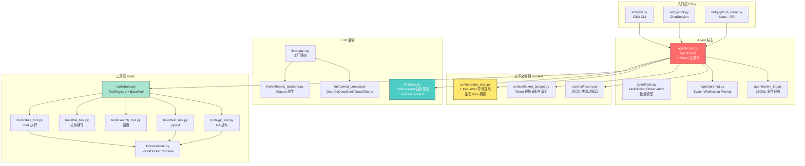
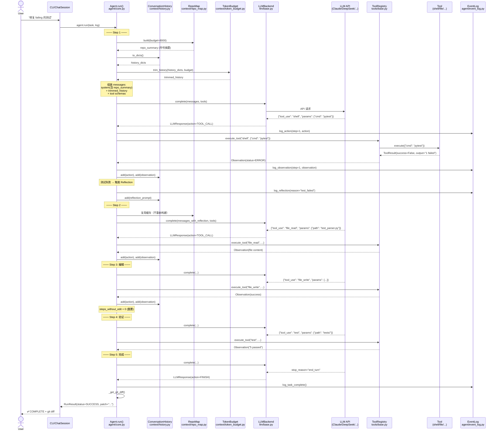
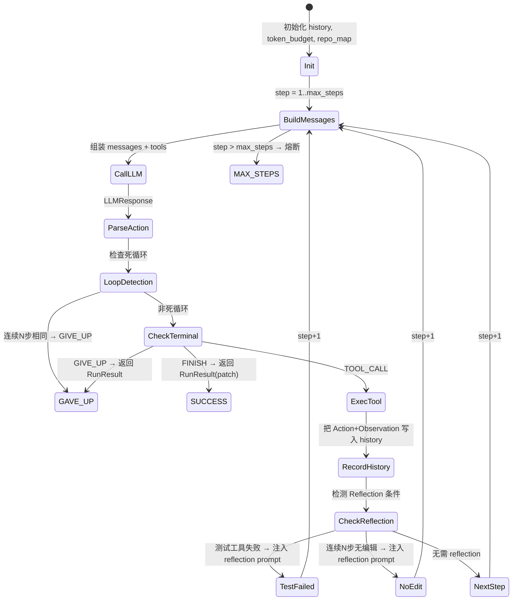
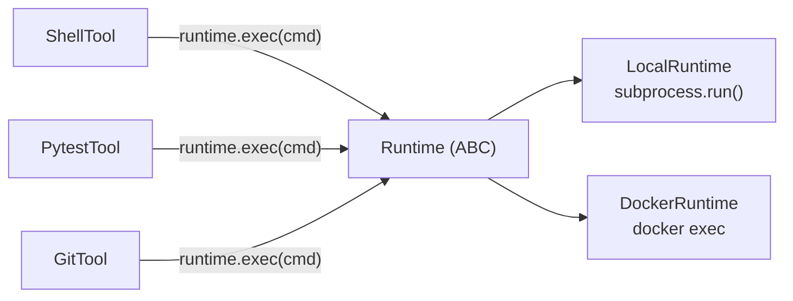
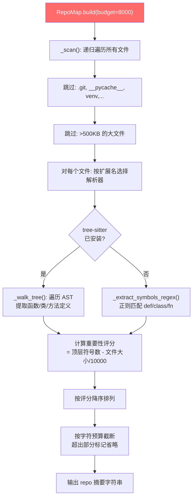
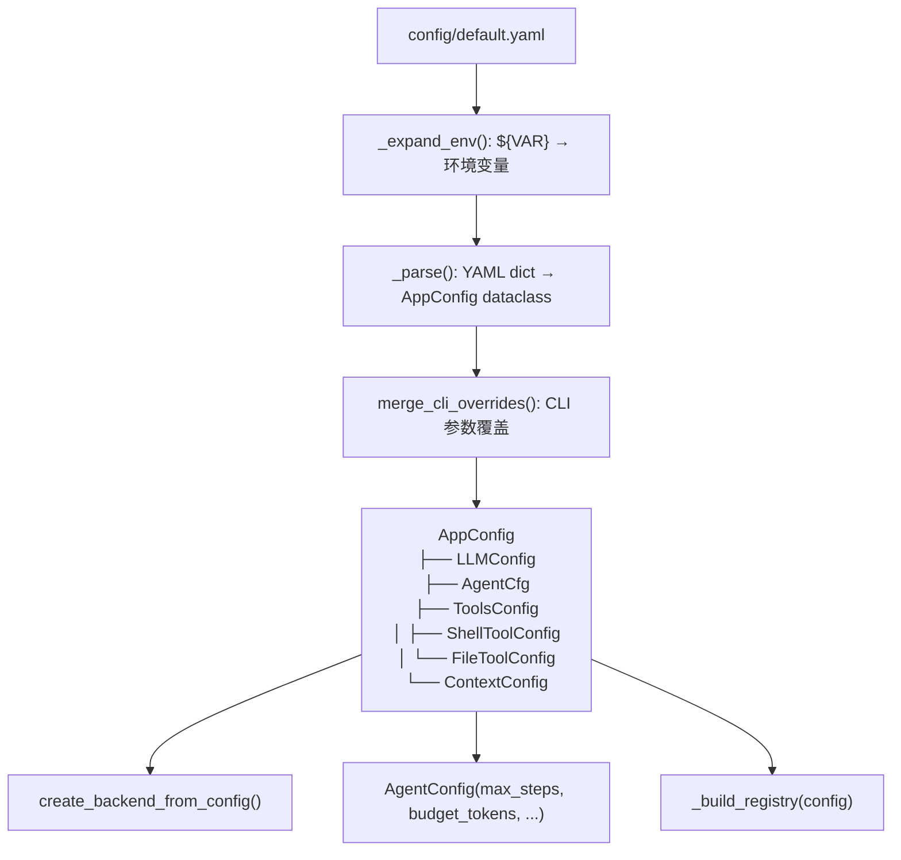

# Forge Agent 深度技术分析

> **一句话概括**：Forge Agent 是一个通用自主编程智能体，融合了 SWE-agent 的 ReAct 架构（观察→思考→行动循环）与 Aider 的 repo-map 技术（tree-sitter 符号提取生成仓库摘要），支持多 LLM 后端、流式输出、Docker 沙箱和 GitHub Issue 自动修复。

---

## 目录

1. [项目总览](#1-项目总览)
2. [技术栈与依赖](#2-技术栈与依赖)
3. [目录结构与模块地图](#3-目录结构与模块地图)
4. [核心架构设计（Mermaid 图）](#4-核心架构设计)
5. [Agent 主循环深度剖析](#5-agent-主循环深度剖析)
6. [工具接口设计与实现](#6-工具接口设计与实现)
7. [上下文管理与超限处理](#7-上下文管理与超限处理)
8. [仓库地图（repo-map）集成](#8-仓库地图repo-map集成)
9. [测试策略与 MockBackend 深度解密](#9-测试策略与-mockbackend-深度解密)
10. [与 SWE-agent 和 Aider 的详细对比](#10-与-swe-agent-和-aider-的详细对比)
11. [配置系统与操作指南](#11-配置系统与操作指南)
12. [设计模式与最佳实践](#12-设计模式与最佳实践)
13. [扩展与二次开发指南](#13-扩展与二次开发指南)
14. [总结与学习路线图](#14-总结与学习路线图)

---

## 1. 项目总览

### 1.1 项目定义

Forge Agent（包名 `coding-agent`）是一个**自主编程智能体**。用户给它一个自然语言任务描述（如"修复 test_parser.py 中失败的测试"），它会自动探索代码库、修改文件、运行测试，直到任务完成。它支持 Claude、DeepSeek、OpenAI、Groq 和 Ollama 五种 LLM 后端，内置流式输出、Docker 沙箱安全执行、以及 GitHub Issue → PR 的全自动流水线。

### 1.2 核心设计目标

该项目的核心设计目标是**融合两种互补的技术路线**：

| 技术来源 | 核心理念 | 本项目继承了什么 |
|---------|---------|----------------|
| **SWE-agent** | 通用 ReAct 循环：LLM 观察环境 → 思考 → 调用工具行动 → 观察结果 → 循环 | 主循环架构、Action/Observation 数据结构、event log 记录 |
| **Aider** | 结对编程体验：用 tree-sitter 生成 repo-map 注入 system prompt，让 LLM 理解代码库结构 | repo-map 模块、tree-sitter 多语言符号提取、按重要性排序注入 |

融合的关键在于：**在 SWE-agent 的 ReAct 循环中，每一步组装 LLM 消息时，动态注入 Aider 风格的 repo-map，让 LLM 同时拥有"环境感知能力"（ReAct）和"代码库全局视野"（repo-map）。**

### 1.3 技术亮点

1. **ReAct + Repo-map 融合**：主循环在每一步都可看到 repo 的符号级结构摘要，而非仅仅依赖工具探索
2. **多 LLM 后端统一抽象**：通过 `LLMBackend` 抽象基类 + Router 工厂模式，一行配置即可切换 Claude/DeepSeek/GPT/Groq/Ollama
3. **MockBackend 测试架构**：用预设 Action 脚本替代真实 LLM 调用，让 376 个测试在 20 秒内跑完
4. **双重 Reflection 机制**：测试失败自动反思 + 连续无编辑步数过长触发反思，防止 agent 陷入无效探索
5. **三层安全防护**：黑名单硬拦截 → 只读白名单免确认 → 写操作回调确认，Docker 沙箱默认断网

---

## 2. 技术栈与依赖

### 2.1 语言与核心依赖

| 依赖 | 作用 |
|------|------|
| Python 3.11+ | 主要编程语言 |
| `anthropic >= 0.30.0` | Claude API 原生 SDK，支持 tool_use 和流式 |
| `openai >= 1.30.0` | OpenAI-compatible SDK，覆盖 DeepSeek/Groq/Ollama |
| `click >= 8.1.0` | CLI 框架，提供 `agent run`/`agent chat`/`agent log` 命令 |
| `rich >= 13.0.0` | 终端富文本（彩色输出） |
| `pyyaml >= 6.0` | 配置文件解析（`config/default.yaml`） |
| `tree-sitter >= 0.22.0` | AST 解析引擎，用于 repo-map 符号提取 |
| `tree-sitter-python >= 0.22.0` | Python 语言语法包（必装） |
| `PyGithub >= 2.3.0` | GitHub API 客户端（Issue 拉取 + PR 创建） |
| `gitpython >= 3.1.0` | Git 操作封装 |

### 2.2 可选依赖

| 依赖 | 作用 |
|------|------|
| `tiktoken >= 0.7.0` | 精确 token 计数（不可用时降级为字符数/4 估算） |
| `tree-sitter-javascript/typescript/go/rust/java` | 更多语言的语法支持 |
| `pytest >= 8.0.0` + `pytest-cov` | 测试框架 |

### 2.3 外部服务需求

- **Docker**（可选）：沙箱模式需要 Docker Desktop 运行，使用 `python:3.11-slim` 镜像
- **LLM API**：至少需要一个 LLM provider 的 API key（DeepSeek/Anthropic/OpenAI/Groq）
- **GitHub Token**（可选）：GitHub Issue 自动修复模式需要 `GITHUB_TOKEN` 环境变量

---

## 3. 目录结构与模块地图

```
forge-agent/
├── agent/                          # 🔴 核心：ReAct 主循环 + 数据模型 + prompt
│   ├── core.py                     #    ⭐ Agent.run() 主循环（整个项目的心脏）
│   ├── task.py                     #    📦 Task/Action/Observation/Event/RunResult 数据类
│   ├── event_log.py                #    📝 JSONL append-only 事件日志
│   └── prompt.py                   #    💬 System prompt + Reflection prompt 模板
│
├── llm/                            # 🔵 LLM 后端层
│   ├── base.py                     #    ⭐ LLMBackend 抽象基类 + MockBackend 测试后端
│   ├── anthropic_backend.py        #    Claude 原生（tool_use + 流式）
│   ├── openai_compat.py            #    OpenAI/DeepSeek/Groq/Ollama（function calling + 文本 fallback）
│   └── router.py                   #    🏭 工厂函数：按 provider 选择 backend
│
├── tools/                          # 🟢 工具层
│   ├── base.py                     #    ⭐ BaseTool 抽象基类 + ToolRegistry + NoopTool/FailingTool
│   ├── shell_tool.py               #    🐚 Shell 执行（四层安全防护）
│   ├── file_tool.py                #    📄 文件读写查看（FileRead/FileView/FileWrite）
│   ├── search_tool.py              #    🔍 文本搜索/文件查找/符号定位
│   ├── test_tool.py                #    🧪 pytest 执行 + 结构化结果解析
│   ├── git_tool.py                 #    🌿 Git 操作（status/diff/add/commit）
│   └── runtime.py                  #    🐳 LocalRuntime / DockerRuntime 抽象层
│
├── context/                        # 🟡 上下文管理
│   ├── repo_map.py                 #    ⭐ tree-sitter 多语言符号提取 + repo 摘要生成
│   ├── token_budget.py             #    📊 Token 预算分配 + 裁剪策略
│   └── history.py                  #    📜 对话历史滑动窗口
│
├── entry/                          # 🟣 入口层
│   ├── cli.py                      #    Click CLI（run/chat/log 子命令）
│   ├── chat.py                     #    💬 ChatSession 持续对话（跨轮 history 保留）
│   └── github_issue.py             #    🐙 GitHub Issue → PR 自动化
│
├── config/                         # ⚙️ 配置
│   ├── default.yaml                #    默认配置文件
│   └── schema.py                   #    YAML → dataclass 解析 + 环境变量展开
│
├── tests/                          # 🧪 376 个测试
│   ├── test_day1.py                #    数据模型 + EventLog 测试
│   ├── test_day2.py                #    Agent 主循环 + MockBackend 全面测试
│   ├── test_day3.py                #    工具层测试（真实文件系统/subprocess）
│   ├── test_day4.py                #    LLM Router + Backend 格式解析（mock SDK）
│   ├── test_day5.py                #    RepoMap + TokenBudget + History + 集成测试
│   ├── test_day6.py                #    Config + CLI（Click test runner）
│   ├── test_day7.py                #    重试逻辑 + git diff patch + 缓存隔离 + 集成
│   ├── test_stream.py              #    流式输出测试
│   ├── test_sandbox.py             #    Docker 沙箱测试
│   ├── test_chat.py                #    ChatSession 多轮对话测试
│   └── test_confirm.py             #    权限确认测试
│
├── smoke_test.py                   # 端到端冒烟测试（真实 LLM 调用）
├── pyproject.toml                  # 项目元数据 + 依赖声明
├── README.md                       # 项目 README
└── USAGE.md                        # 完整使用教程
```

> ⭐ = 本文档重点分析的核心文件

---

## 4. 核心架构设计

### 4.1 高层组件图



### 4.2 完整流程序列图：从 Issue 到 Patch



---

## 5. Agent 主循环深度剖析

### 5.1 位置

主循环位于 **`agent/core.py`** 的 `Agent.run()` 方法（第 95-269 行）。

```
agent/core.py
├── AgentConfig (dataclass) — 运行时配置
└── class Agent
    ├── __init__(backend, registry, config)
    ├── run(task, log) → RunResult     ⭐ 主循环
    ├── _build_messages(...)           — 组装 LLM 输入
    ├── _format_action_for_history()   — Action → LLM 消息
    ├── _format_observation_for_history() — Observation → LLM 消息
    ├── _is_looping(log)               — 死循环检测
    ├── _call_with_retry(...)          — 带重试的 LLM 调用
    └── _get_git_diff(repo_path)       — 提取 git diff
```

### 5.2 主循环状态机



### 5.3 核心循环代码（带注释走读）

以下是 `agent/core.py` 中 `Agent.run()` 的核心逻辑（简化 + 注释版）：

```python
def run(self, task: Task, log: EventLog) -> RunResult:
    # ── 初始化 ──
    # 共享 history（chat 模式跨轮复用；单次 run 新建）
    history = self._pending_history or ConversationHistory(...)
    # Token 预算管理器
    token_budget = TokenBudget(total=self._cfg.budget_tokens)
    # Repo-map 生成器（缓存 key = repo_path）
    repo_map = RepoMap(task.repo_path)

    total_tokens = 0
    steps_without_edit = 0  # 追踪连续无编辑步数

    # ── ReAct 主循环 ──
    for step in range(1, task.max_steps + 1):

        # 1️⃣ 组装 messages
        #    system prompt 包含 repo-map 摘要 + 工具列表
        #    history 经过 TokenBudget 裁剪
        messages = self._build_messages(history, token_budget, repo_map)
        tools = self._registry.get_schemas()

        # 2️⃣ 调用 LLM（带指数退避重试）
        response = self._call_with_retry(messages, tools)

        total_tokens += response.total_tokens
        action = response.action

        # 3️⃣ 写入 Action event
        log.log_action(step=step, action=action)

        # 4️⃣ 死循环检测
        #    比较最近 N 条 action 的 (tool_name, params) 是否完全一致
        if self._is_looping(log):
            return RunResult(status=RunStatus.GAVE_UP, ...)

        # 5️⃣ 终止判断
        if action.action_type == ActionType.FINISH:
            patch = self._get_git_diff(task.repo_path)  # 提取 git diff
            return RunResult(status=RunStatus.SUCCESS, patch=patch, ...)

        if action.action_type == ActionType.GIVE_UP:
            return RunResult(status=RunStatus.GAVE_UP, ...)

        # 6️⃣ 执行工具
        if action.action_type == ActionType.TOOL_CALL:
            tc = action.tool_call
            result = self._registry.execute_tool(tc.name, tc.params)
            observation = result.to_observation(tc.name)

            # 追踪文件编辑
            if tc.name in ("file_write", "file_edit", "edit"):
                steps_without_edit = 0
            else:
                steps_without_edit += 1

            # 写入 Observation event
            log.log_observation(step=step, observation=observation)

            # 注入对话历史（Thought + Action + Observation）
            history.add(LLMMessage(role="assistant", content=format_action(action)))
            history.add(LLMMessage(role="user", content=format_obs(observation)))

            # 7️⃣ Reflection 触发判断
            # A: 测试工具失败
            if tc.name in test_tool_names and not observation.is_success():
                history.add(LLMMessage(role="user", content=REFLECTION_TEST_FAILED))
                log.log_reflection(step=step, reason="test_failed")

            # B: 连续 N 步无编辑
            elif steps_without_edit >= self._cfg.reflection_no_edit_steps:
                history.add(LLMMessage(role="user", content=REFLECTION_NO_EDIT))
                log.log_reflection(step=step, reason="no_edit")
                steps_without_edit = 0

    # 8️⃣ 超出步数熔断
    return RunResult(status=RunStatus.MAX_STEPS, ...)
```

### 5.4 与 SWE-agent 的 ReAct 循环对比

| 维度 | SWE-agent 经典 ReAct | Forge Agent |
|------|---------------------|-------------|
| **循环结构** | Observe → Think → Act → Observe | 完全继承：`_build_messages` → LLM → Execute Tool → History → 下一轮 |
| **观察（Observe）** | 主要是 shell 命令输出和文件内容 | 同样，额外增加了 repo-map 作为"被动观察"注入 system prompt |
| **思考（Think）** | LLM 在输出 action 前输出 `thought` 字段 | 完全继承：每个 Action 都有 `thought` 字段，写入 event log |
| **行动（Act）** | 调用有限工具集 | 扩展了工具集（file_view 分页读取、find_symbol 符号搜索） |
| **终止条件** | FINISH / max_steps | 增加了 GIVE_UP（主动放弃）和 dead loop detection（死循环检测） |
| **反思（Reflection）** | 无内置机制 | **独创**：测试失败自动反思 + 连续无编辑反思 |
| **数据模型** | 自行设计 | 与 SWE-agent 类似：Task → Action → Observation 三段式 |
| **Event Log** | 自定义格式 | JSONL append-only，支持 replay 和统计 |

---

## 6. 工具接口设计与实现

### 6.1 接口设计：BaseTool 抽象基类

工具层定义在 `tools/base.py`，所有工具必须实现 `BaseTool` 抽象基类：

```python
class BaseTool(ABC):
    @property
    @abstractmethod
    def name(self) -> str:
        """工具名称，如 "shell", "file_read"。必须全局唯一。"""
        ...

    @property
    @abstractmethod
    def description(self) -> str:
        """工具功能描述，注入 LLM 的 system prompt 和 tool schema。"""
        ...

    @property
    @abstractmethod
    def parameters_schema(self) -> dict[str, Any]:
        """参数的 JSON Schema。"""
        ...

    @abstractmethod
    def execute(self, params: dict[str, Any]) -> ToolResult:
        """执行工具，返回 ToolResult。不抛异常，错误封装在 ToolResult.error 里。"""
        ...

    def to_llm_schema(self) -> LLMToolSchema:
        """生成供 LLM 使用的 schema。"""
        return LLMToolSchema(
            name=self.name,
            description=self.description,
            parameters=self.parameters_schema,
        )
```

### 6.2 设计逻辑

**为什么这样设计？**

1. **单一抽象基类**：所有工具共享 `execute(params) → ToolResult` 接口，`Agent.run()` 完全不需要知道工具的具体实现——它只通过 `ToolRegistry.execute_tool(name, params)` 调用，这是经典的**策略模式**。

2. **JSON Schema 自描述**：每个工具提供自己的 `parameters_schema`，由 `ToolRegistry.get_schemas()` 汇总后注入 LLM 的 `tools` 参数。新增工具时只需实现这三个 property 和一个方法，不需要改 Agent 代码——**开放-封闭原则**。

3. **错误不抛异常**：`execute()` 不拋异常，错误封装在 `ToolResult.error` 中。这让 Agent 可以优雅地处理工具错误（如文件不存在），继续下一轮尝试，而不是崩溃。

4. **runtime 依赖注入**：`ShellTool`、`PytestTool`、`GitTool` 都接受可选的 `Runtime` 参数。默认是 `LocalRuntime`（subprocess），测试时可注入 mock，生产时可注入 `DockerRuntime`——**依赖反转原则**。

### 6.3 所有可用工具

| 工具名 | 类 | 文件 | 输入 | 输出 | 特殊说明 |
|-------|-----|------|------|------|---------|
| `shell` | `ShellTool` | `tools/shell_tool.py` | `cmd`, `timeout`, `cwd` | stdout + stderr | 四层安全防护 |
| `file_read` | `FileReadTool` | `tools/file_tool.py` | `path` | 行号化的文件内容 | >500行截断，提示用 file_view |
| `file_view` | `FileViewTool` | `tools/file_tool.py` | `path`, `start_line` | 100行窗口 | 分页查看大文件 |
| `file_write` | `FileWriteTool` | `tools/file_tool.py` | `path`, `content` | 写入行数确认 | 自动创建父目录 |
| `search_text` | `SearchTextTool` | `tools/search_tool.py` | `pattern`, `path`, `file_pattern`, `case_sensitive` | 匹配行 + 行号 | 支持正则，最多50结果 |
| `find_files` | `FindFilesTool` | `tools/search_tool.py` | `pattern`, `path` | 匹配的文件路径列表 | glob 模式 |
| `find_symbol` | `FindSymbolTool` | `tools/search_tool.py` | `symbol`, `path` | 函数/类定义位置 | 正则匹配 def/class |
| `test` | `PytestTool` | `tools/test_tool.py` | `path`, `args`, `cwd` | 结构化测试结果 | 成功时返回统计行，失败时返回失败列表 |
| `git_status` | `GitStatusTool` | `tools/git_tool.py` | `cwd` | `git status --short --branch` | |
| `git_diff` | `GitDiffTool` | `tools/git_tool.py` | `staged`, `path`, `cwd` | diff 内容 | >8000 字符截断 |
| `git_add` | `GitAddTool` | `tools/git_tool.py` | `paths`, `cwd` | 暂存确认 | |
| `git_commit` | `GitCommitTool` | `tools/git_tool.py` | `message`, `cwd` | commit 结果 | |

### 6.4 工具注册表（ToolRegistry）

```python
class ToolRegistry:
    def register(self, tool: BaseTool) -> "ToolRegistry":  # 链式调用
    def execute_tool(self, name, params) -> ToolResult:     # 查找+执行
    def get_schemas(self) -> list[LLMToolSchema]:           # 生成全部 schema
```

注册方式（在 `entry/cli.py::_build_registry`）：

```python
ToolRegistry()
    .register(ShellTool(confirm_callback=..., runtime=...))
    .register(FileReadTool())
    .register(FileViewTool())
    .register(FileWriteTool())
    .register(SearchTextTool())
    .register(FindFilesTool())
    .register(FindSymbolTool())
    .register(PytestTool(runtime=...))
    .register(GitStatusTool(runtime=...))
    .register(GitDiffTool(runtime=...))
    .register(GitAddTool(runtime=...))
    .register(GitCommitTool(runtime=...))
```

### 6.5 与沙箱/执行环境的交互

通过 **Runtime 抽象层**（`tools/runtime.py`）将命令执行与工具解耦：



`DockerRuntime` 的特性：
- **懒启动**：首次调用 `exec()` 时才启动容器
- **Bind mount**：repo 目录双向同步（宿主机↔容器）
- **默认断网**：`--network none`
- **自动清理**：session 结束或 `cleanup()` 时 `docker rm -f`

---

## 7. 上下文管理与超限处理

### 7.1 上下文窗口的组成部分

每条 LLM 请求的上下文由以下部分组成：

```
┌──────────────────────────────────────────────────┐
│ 1. System Prompt（始终保留）                       │
│    ├── 角色指令 (Workflow + Rules)                │
│    ├── Repo 路径                                  │
│    ├── Repo-map 摘要（tree-sitter 符号提取）       │
│    └── 可用工具列表                               │
├──────────────────────────────────────────────────┤
│ 2. History Messages（可裁剪）                     │
│    ├── [0] 任务描述 (user，永不丢弃)              │
│    ├── [1] assistant: Thought + Action            │
│    ├── [2] user: Observation                      │
│    ├── [3] assistant: Thought + Action            │
│    ├── [4] user: Observation + Reflection prompt  │
│    └── ... (最近 N 轮，从旧到新裁剪)              │
├──────────────────────────────────────────────────┤
│ 3. Tool Schemas（function calling 定义）           │
└──────────────────────────────────────────────────┘
```

### 7.2 Token 预算分配策略

`TokenBudget` 类（`context/token_budget.py`）将总预算按优先级分配：

```python
def default_plan(self) -> BudgetPlan:
    total = 80_000           # 总预算
    reserve = total * 0.15   # 15% 安全预留
    available = total - reserve
    return BudgetPlan(
        system_core = available * 0.10,   # 系统指令（最高优先级）
        repo_map    = available * 0.15,   # repo 摘要
        history     = available * 0.50,   # 对话历史（最大份额）
        observation = available * 0.25,   # 最近观察结果
    )
```

**优先级队列（从高到低）**：

1. **system_core**（10%）— 系统指令，永不裁剪
2. **task** — 任务描述（history 第 0 条），永不裁剪
3. **recent_obs**（25%）— 最近 observation，永不裁剪
4. **repo_map**（15%）— 超出时缩减
5. **history**（50%）— 从最旧的（非首条）开始裁剪

### 7.3 具体裁剪策略

#### 策略 1：对话历史滑动窗口（数量维度）

`ConversationHistory`（`context/history.py`）提供基于**消息条数**的初级裁剪：

```python
def _trim(self) -> None:
    while len(self._messages) > self._max:  # 默认 40 条
        if len(self._messages) > 1:
            self._messages.pop(1)  # 保留 index 0（任务描述），从 index 1 开始丢
```

#### 策略 2：TokenBudget 二次裁剪（Token 数量维度）

`TokenBudget.trim_history()` 提供基于**Token 数量**的二次裁剪：

```python
def trim_history(self, messages, token_limit):
    # 1. 保留第 0 条（任务描述），计算剩余 Token 预算
    result = [messages[0]]
    remaining_budget = token_limit - estimate_tokens(messages[0].content)

    # 2. 从最新消息开始向前选择（尽量保留最近的）
    selected = []
    budget_left = remaining_budget
    for msg in reversed(messages[1:]):
        tokens = estimate_tokens(msg.content)
        if budget_left - tokens >= 0:
            selected.append(msg)
            budget_left -= tokens
        else:
            dropped += 1

    # 3. 插入截断提示
    if dropped > 0:
        result.append({
            "role": "user",
            "content": f"[{dropped} earlier messages were truncated...]",
        })
    result.extend(reversed(selected))
    return result
```

#### 策略 3：repo_map 预算裁剪

`RepoMap.build(budget)` 按 "重要性" 排序文件后裁剪：

- 重要性评分 = 顶层符号数 - 文件大小/10000（小文件有优势）
- 按字符预算 `budget * 4` 截断，超出的文件标记为 `"... (N more files not shown)"`

#### 策略 4：单条文本裁剪

`TokenBudget.trim_to(text, token_limit)` 对单条文本做二分截断：

```python
def trim_to(self, text, token_limit):
    if estimate_tokens(text) <= token_limit:
        return text
    char_limit = token_limit * 4
    candidate = text[:char_limit]
    while estimate_tokens(candidate) > token_limit and len(candidate) > 0:
        candidate = candidate[:int(len(candidate) * 0.9)]  # 每次缩 10%
    return candidate + f"\n... [{omitted} tokens truncated]"
```

#### 策略 5：工具输出截断

- Shell 输出：`_truncate(output, 8000)` — 保留头部 60% + 尾部 40%
- Git diff：`output[:8000]` — 只保留头部
- Pytest 输出：`raw[-6000:]` — 失败时保留尾部（错误信息在末尾）
- File read：`lines[:500]` — 只保留前 500 行

### 7.4 Token 计数

优先使用 `tiktoken`（`cl100k_base` 编码），不可用时降级为 `len(text) // 4`（误差 <15%）：

```python
def estimate_tokens(text: str) -> int:
    if _tiktoken_available:
        return max(1, len(_tiktoken_enc.encode(text)))
    return max(1, len(text) // 4)  # 字符估算 fallback
```

---

## 8. 仓库地图（repo-map）集成

### 8.1 Repo-map 生成流程



### 8.2 Tree-sitter 多语言支持

通过 `_LANG_REGISTRY` 注册表实现可扩展的多语言支持（`context/repo_map.py`）：

```python
_LANG_REGISTRY = {
    ".py":   ("tree_sitter_python", "language"),
    ".js":   ("tree_sitter_javascript", "language"),
    ".ts":   ("tree_sitter_typescript", "language_typescript"),
    ".tsx":  ("tree_sitter_typescript", "language_tsx"),
    ".go":   ("tree_sitter_go", "language"),
    ".rs":   ("tree_sitter_rust", "language"),
    ".java": ("tree_sitter_java", "language"),
    ".cpp":  ("tree_sitter_cpp", "language"),
    ".c":    ("tree_sitter_c", "language"),
    ".rb":   ("tree_sitter_ruby", "language"),
}
```

运行时按需 import 语言包，失败时静默降级为正则 fallback，不报错。

### 8.3 识别的 AST 节点类型

```python
_FUNC_NODES = frozenset({
    "function_definition",        # Python, Go, C, C++
    "async_function_definition",  # Python async def
    "function_declaration",       # JS, TS, Java
    "method_declaration",         # Java
    "method_definition",          # JS class method
    "function_item",              # Rust fn
})

_CLASS_NODES = frozenset({
    "class_definition",        # Python
    "class_declaration",       # JS, TS, Java
    "struct_item",             # Rust struct
    "impl_item",               # Rust impl
    "interface_declaration",   # TS/Java
})
```

### 8.4 repo-map 注入 Prompt 的方式

在 `agent/core.py::_build_messages()` 中，repo-map 被注入 system prompt 的 `{repo_summary}` 占位符：

```python
# agent/prompt.py
_SYSTEM_TEMPLATE = """\
...
## Repository
Path: {repo_path}
{repo_summary}           ← repo-map 注入位置

## Available tools
{tool_descriptions}
"""
```

repo-map 的输出格式示例：

```
sub/module.py (1 symbol):
  class SubModule (line 1)
main.py (2 symbols):
  function run (line 1)
  class App (line 3)
    method start (line 4)
utils.py (2 symbols):
  function helper (line 1)
  function another (line 3)
```

### 8.5 缓存策略

repo-map 在 Agent 内有**两层缓存**：

1. **同一次 `run()` 内**：只在第一步构建，后续步骤复用 `_repo_map_cache` 属性
2. **跨 repo 隔离**：换 repo 时自动失效（通过 `_repo_map_cache_key` 检测）

```python
# agent/core.py
cache_key = task.repo_path
if getattr(self, "_repo_map_cache_key", None) != cache_key:
    if hasattr(self, "_repo_map_cache"):
        del self._repo_map_cache  # 换 repo → 清缓存，下次重建
    self._repo_map_cache_key = cache_key
```

### 8.6 与 Aider repo-map 的异同

| 维度 | Aider | Forge Agent |
|------|-------|-------------|
| **符号提取** | tree-sitter（同样） | tree-sitter + 正则 fallback |
| **语言支持** | Python only（主要） | Python/JS/TS/Go/Rust/Java/C/C++/Ruby |
| **排序算法** | 基于使用的相关性排名 | 简单的重要性评分（顶层符号数 - 文件大小惩罚） |
| **更新策略** | 每次文件修改后增量更新 | 整个 run 内只构建一次（缓存） |
| **注入方式** | 注入 system prompt | 同样注入 system prompt 的 `{repo_summary}` 占位符 |
| **预算控制** | 有类似机制 | TokenBudget 明确分配 15% 给 repo_map |
| **缓存** | 有增量更新 | 简单缓存（整个 run 复用），换 repo 重建 |

**关键差异**：Aider 在每次文件编辑后更新 repo-map（因为结对编程中频繁小修改需要即时反馈），而 Forge Agent 在整个 run 内复用第一次构建的地图（因为 agent 的探索范围通常不超出初始地图范畴）。这是一个合理的简化。

---

## 9. 测试策略与 MockBackend 深度解密

### 9.1 总体测试架构

```
376 个测试分布在 10 个测试文件中，按"Day"组织（对应开发阶段）：
```

| 测试文件 | 测试数（约） | 覆盖范围 | Mock 策略 |
|---------|------------|---------|----------|
| `test_day1.py` | ~30 | 数据模型构造/序列化/反序列化，EventLog 写入/replay | 无 mock（纯数据） |
| `test_day2.py` | ~50 | Agent 主循环全路径（成功/放弃/熔断/死循环/Reflection/错误） | **MockBackend** + NoopTool/FailingTool |
| `test_day3.py` | ~60 | 工具层（文件/Shell/搜索/pytest/Git） | 真实文件系统 + subprocess |
| `test_day4.py` | ~50 | LLM Router + Backend 格式解析 + Prompt 模板 | `unittest.mock.patch` SDK |
| `test_day5.py` | ~55 | RepoMap + TokenBudget + History + 集成 | MockBackend + 真实文件系统 |
| `test_day6.py` | ~35 | Config 加载 + CLI（Click test runner） | MockBackend + `patch` Config |
| `test_day7.py` | ~40 | 重试逻辑 + git diff + 缓存隔离 + 集成 | MockBackend + 真实 git |
| `test_stream.py` | ~25 | 流式输出路径 + StreamCallback | MockBackend + 自定义 stream() |
| `test_sandbox.py` | ~30 | LocalRuntime + DockerRuntime（单元 + 集成） | Mock subprocess + 真实 Docker（标记 skipif） |
| `test_chat.py` | ~20 | ChatSession 多轮对话 + History 跨轮传递 | MockBackend |
| `test_confirm.py` | ~25 | Shell 安全层 + 确认回调 | 真实 ShellTool + 各种 callback |

### 9.2 测试覆盖的核心功能

- ✅ 主循环的 6 种终止路径（SUCCESS / GAVE_UP / MAX_STEPS / LOOP / LLM_ERROR / UNKNOWN_TOOL）
- ✅ 两种 Reflection 触发条件（test_failed / no_edit）
- ✅ 死循环检测（连续 N 步相同 action）
- ✅ 工具注册表（注册/执行/去重/错误处理/异常保护）
- ✅ 所有 12 个工具（每个工具的正向和异常路径）
- ✅ LLM 格式转换（Anthropic tool_use 解析 / OpenAI function calling 解析 / 文本 fallback）
- ✅ Token 预算裁剪（history 裁剪 / repo_map 裁剪 / 单条消息裁剪）
- ✅ Repo-map 生成（tree-sitter 提取 / 正则 fallback / 缓存 / 预算截断）
- ✅ 多 LLM Router（5 种 provider / API key 解析 / 环境变量读取）
- ✅ Config 加载（YAML 解析 / 环境变量展开 / CLI 覆盖）
- ✅ 流式输出（stream path / callback 回调 / 重试）
- ✅ 安全机制（黑名单 / 白名单 / 确认回调）
- ✅ 多轮对话（History 跨轮保留 / 统计累计 / clear）
- ✅ 重试逻辑（指数退避 / 不重试 4xx 错误）

### 9.3 MockBackend 详解

#### 它是什么？

`MockBackend` 是一个**模拟 LLM 的后端**，定义在 `llm/base.py` 第 132-201 行。它实现了 `LLMBackend` 的全部接口，但**不调用任何 LLM API**。相反，它按预设的 "Action 脚本" 顺序返回结果。

#### 工作原理

```python
class MockBackend(LLMBackend):
    def __init__(self, script: list[Action], input_tokens=100, output_tokens=50):
        self._script = script      # 预设的 Action 列表
        self._index = 0            # 当前播放位置
        self.call_count = 0        # 调用计数
        self.received_messages = []  # 记录所有接收到的消息（供测试断言）

    def complete(self, messages, tools) -> LLMResponse:
        self.call_count += 1
        self.received_messages.append(messages)

        if self._index < len(self._script):
            action = self._script[self._index]  # 按剧本返回
            self._index += 1
        else:
            action = Action(GIVE_UP, "Script exhausted.")  # 脚本用尽，自动放弃

        return LLMResponse(
            action=action,
            raw_content=f"[mock] {action!r}",
            input_tokens=self._input_tokens,
            output_tokens=self._output_tokens,
        )
```

#### 如何"欺骗" Agent 主循环？

关键在于 `MockBackend.complete()` 返回的 `LLMResponse` 与真实 `AnthropicBackend` / `OpenAICompatBackend` 返回的**格式完全一致**：

```
真实 Backend 流程：
  messages + tools → HTTP 请求 → LLM API → JSON 响应 → 解析 → LLMResponse(Action)

MockBackend 流程：
  messages + tools → 忽略 → 按脚本返回 → LLMResponse(Action)
```

Agent 主循环只依赖于 `LLMResponse.action`，完全不关心这个 Action 是 LLM 生成的还是脚本预设的。这就是**依赖倒置**的威力：`Agent` 依赖抽象 `LLMBackend`，而非具体实现。

#### 核心优势

| 特性 | 真实 LLM | MockBackend |
|------|---------|-------------|
| 单次调用延迟 | 500ms – 10s+ | ~0ms（同步返回） |
| 网络依赖 | 需要 | 不需要 |
| API 费用 | 每次调用计费 | $0 |
| 确定性 | 非确定性（即使 temperature=0 也有差异） | 完全确定（脚本什么就返回什么） |
| 路径控制 | 无法精确控制 LLM 选择哪个工具 | 可精确测试每条代码路径 |
| 并发 | 受 API rate limit 限制 | 无限并发 |

#### 性能数据：为什么 376 个测试能在 20 秒内跑完？

1. **无网络延迟**：MockBackend 的 `complete()` 是纯内存操作，耗时 ~0ms，而真实 LLM API 调用通常需要 500ms–10s+
2. **无推理时间**：不需要等待模型生成 token
3. **完全同步**：没有异步 I/O 开销
4. **小数据集**：大多数测试使用 `tmp_path` fixture（临时目录），文件操作极快
5. **精确的路径控制**：一个测试只测一条路径，不需要多轮 LLM 交互

假设一个测试需要 agent 走 3 步（3 次 LLM 调用），真实 LLM 每次 1s → 3s/测试。376 个测试 × 3s ≈ 19 分钟。MockBackend 则只需要 `376 × 3 × 0.001s ≈ 1s` 的 LLM 调用时间，其余时间是文件 I/O 和 subprocess。

### 9.4 完整的 Mock 工具箱

| Mock 工具 | 位置 | 用途 | 使用场景 |
|-----------|------|------|---------|
| `MockBackend` | `llm/base.py:133` | 预设 Action 脚本，不调用 LLM | **所有** agent 核心逻辑测试 |
| `NoopTool` | `tools/base.py:176` | execute() 直接返回成功 | 不需要真实工具执行的 agent 流程测试 |
| `FailingTool` | `tools/base.py:212` | execute() 始终返回失败 | Reflection 触发测试 |
| `LocalRuntime` | `tools/runtime.py:115` | 真实 subprocess（非 mock） | 工具层测试（需要真实 Shell 命令） |
| `unittest.mock.patch` | 标准库 | Mock SDK 调用 | Backend 格式解析测试（不调真实 API） |
| `Click CliRunner` | Click 内置 | 模拟 CLI 调用 | CLI 参数解析和输出测试 |
| `tmp_path` fixture | pytest | 临时目录隔离 | 所有涉及文件系统的测试 |

### 9.5 MockBackend 核心代码逐行解析

```python
class MockBackend(LLMBackend):
    """
    测试专用 backend，按脚本顺序返回预设的 Action。

    用法：
        script = [
            Action(ActionType.TOOL_CALL, "run tests", ToolCall("shell", {"cmd": "pytest"})),
            Action(ActionType.FINISH, "all tests pass", message="Done"),
        ]
        backend = MockBackend(script)
        # 每次调用 complete() 返回 script 中的下一个 Action
        # 脚本用完后自动返回 GIVE_UP
    """

    def __init__(self, script, input_tokens=100, output_tokens=50):
        self._script = script           # ← 预设的"剧本"，Action 列表
        self._index = 0                 # ← "播放头"，当前到第几行了
        self._input_tokens = input_tokens   # ← 模拟的输入 token 数
        self._output_tokens = output_tokens # ← 模拟的输出 token 数
        self.call_count = 0             # ← 记录被调用了多少次（供断言）
        self.received_messages = []     # ← 记录每次收到的消息（供断言）

    @property
    def model_name(self) -> str:
        return "mock-model"             # ← 标识为 mock，日志中可见

    def complete(self, messages, tools) -> LLMResponse:
        self.call_count += 1            # ← 每次调用计数 +1
        self.received_messages.append(messages)  # ← 保存消息副本

        if self._index < len(self._script):
            action = self._script[self._index]  # ← 按剧本返回当前 Action
            self._index += 1            # ← 播放头前进
        else:
            # 剧本用完，返回 GIVE_UP 防止死循环
            action = Action(
                action_type=ActionType.GIVE_UP,
                thought="MockBackend script exhausted.",
                message="No more scripted actions.",
            )

        return LLMResponse(
            action=action,
            raw_content=f"[mock] {action!r}",  # ← mock 标记，调试可见
            input_tokens=self._input_tokens,    # ← 恒定的模拟 token
            output_tokens=self._output_tokens,
        )

    def reset(self):
        """重置脚本指针，复用同一个 backend 跑多个测试。"""
        self._index = 0
        self.call_count = 0
        self.received_messages.clear()
```

**典型测试用例**（来自 `tests/test_day2.py`）：

```python
def test_finish_after_tool_calls(self, task, log, registry):
    # 预设剧本：先两次 TOOL_CALL，再 FINISH
    script = [
        make_tool_call_action("shell"),
        make_tool_call_action("file_read"),
        make_finish_action("Done after exploration."),
    ]
    backend = MockBackend(script)
    agent = Agent(backend, registry)

    result = agent.run(task, log)

    # 断言：agent 按剧本走了 3 步后成功
    assert result.status == RunStatus.SUCCESS
    assert result.steps_taken == 3
```

### 9.6 其他 Mock 策略

**沙箱测试中的 Docker Mock**：`tests/test_sandbox.py::TestDockerRuntimeUnit` 通过 `patch("subprocess.run")` 拦截所有 Docker 命令，返回预设的 subprocess 结果，不需要真实 Docker：

```python
def test_docker_unavailable_returns_error(self, tmp_path):
    rt = DockerRuntime(repo_path=str(tmp_path))
    with patch("subprocess.run") as mock_run:
        mock_run.return_value = MagicMock(returncode=1, stderr="Cannot connect")
        result = rt.exec("echo hello")
    assert not result.success
    assert "not available" in result.stderr.lower()
```

**文件系统**：工具层测试（`test_day3.py`）使用**真实文件系统**（`tmp_path` fixture），因为工具的价值就在于真实执行。但 agent 核心测试使用 `NoopTool` 来避免文件系统依赖。

**LLM SDK Mock**：`test_day4.py` 通过 `patch("anthropic.Anthropic")` 和 `patch("openai.OpenAI")` 拦截 SDK 初始化，然后用 `MagicMock` 构造 API 响应，验证格式解析逻辑。

---

## 10. 与 SWE-agent 和 Aider 的详细对比

### 10.1 架构对比表

| 维度 | SWE-agent | Aider | Forge Agent |
|------|-----------|-------|-------------|
| **主循环** | ReAct（Observe→Think→Act） | REPL 对话循环 | ReAct + Reflection 触发 |
| **核心创新** | 通用自主 Agent 框架 | Tree-sitter repo-map + 结对编程 | ReAct + Repo-map 融合 + 多后端统一 |
| **LLM 后端** | 支持多后端但偏重 Claude | 支持多后端但配置灵活 | 5 种后端，统一抽象，一行配置切换 |
| **工具集** | bash、文件编辑、搜索 | shell (通过用户批准)、文件编辑、git | 12 个工具（shell/file/search/test/git），三层安全 |
| **上下文管理** | Truncation-based | 滑动窗口 + tree-sitter 结构注入 | 双层裁剪（条数 + Token） + repo-map 注入 |
| **Repo-map** | 无 | 核心特性：tree-sitter 提取符号，排序注入 | 借鉴 Aider：tree-sitter + 正则 fallback，8 种语言 |
| **沙箱** | Docker 沙箱 | 无（在用户终端执行） | Docker 懒启动 + bind mount + 默认断网 |
| **流式输出** | 有限支持 | 支持 | 完整的流式支持（thought + message 分别回调） |
| **Reflection** | 无内置 | 无（依赖 LLM 自身判断） | **独创**：测试失败 + 无编辑双重触发 |
| **事件日志** | 自定义 | 无结构化日志 | JSONL append-only，支持 replay 和统计 |
| **测试策略** | 集成测试为主 | 单元测试为主 | MockBackend 为核心的 376 个全覆盖测试 |
| **CLI 入口** | `sweagent` | `aider` | `agent run` / `agent chat` / `agent log` |
| **GitHub 集成** | 无 | 无 | Issue 拉取 → Agent 修复 → PR 创建全自动 |

### 10.2 设计哲学对比

| 项目 | 设计哲学 | 主要用户 |
|------|---------|---------|
| **SWE-agent** | "通用自主 Agent 框架" —— 追求最大通用性，可适配各种环境和工具 | 研究者、SWE-bench 测评 |
| **Aider** | "结对编程助手" —— 追求最佳人机交互体验，像人类配对程序员一样工作 | 日常开发中的开发者 |
| **Forge Agent** | "实用自主修复工具" —— 追求最小化上手门槛和多模型灵活性 | 个人开发者、中小团队 |

### 10.3 技术复用分析

**来自 SWE-agent 的设计遗产**：

1. **ReAct 循环结构**：`Observe → Think → Act` 三段式，每一步的 thought 和 tool_call 分离
2. **Action/Observation 数据模型**：action_type 枚举（TOOL_CALL/FINISH），observation status（SUCCESS/ERROR）
3. **工具注册表模式**：中心化工具注册，按名称查找执行
4. **Event log 概念**：记录每一步的输入输出

**来自 Aider 的设计遗产**：

1. **repo-map 模块**：`context/repo_map.py` 直接借鉴 Aider 的思路
2. **tree-sitter 符号提取**：`_walk_tree()` 递归遍历 AST 提取函数/类定义
3. **重要性排序**：按顶层符号数和文件大小排序，优先展示小文件
4. **Prompt 注入模式**：将 repo-map 注入 system prompt 的固定位置

### 10.4 Forge Agent 的独有创新

1. **双重 Reflection 机制**：SWE-agent 和 Aider 都没有内置的 self-reflection 触发逻辑。Forge Agent 在测试失败和连续无编辑两种情况下自动注入 reflection prompt。

2. **死循环检测**：比较连续 N 步的 `(tool_name, params)` 元组，完全相同的判定为死循环，自动熔断。

3. **四层安全模型**：黑名单硬拦截 → 只读白名单 → 回调确认 → timeout + 输出截断。SWE-agent 有 bash 安全检查但不如这里分层细致。Aider 依赖用户的交互确认。

4. **LLM 后端的文本解析 fallback**：当模型不支持 function calling 时（如 DeepSeek R1），自动切换为"在 system prompt 中注入工具描述 → 要求模型输出 JSON → 正则解析"的路径。

5. **统一的多后端 Router**：通过 `_PROVIDER_BASE_URLS` 一张字典表 + `OpenAICompatBackend` 一个类覆盖 OpenAI/DeepSeek/Groq/Ollama 四种后端，极大简化了后端管理。

6. **Docker 沙箱的懒启动 + Bind mount**：比 SWE-agent 的每条命令一个容器更高效（复用容器），比 Aider 的无沙箱更安全。

---

## 11. 配置系统与操作指南

### 11.1 配置系统架构



### 11.2 所有环境变量

| 环境变量 | 用途 | 必填？ |
|---------|------|--------|
| `DEEPSEEK_API_KEY` | DeepSeek API Key | provider=deepseek 时 |
| `ANTHROPIC_API_KEY` | Anthropic Claude API Key | provider=anthropic 时 |
| `OPENAI_API_KEY` | OpenAI API Key | provider=openai 时 |
| `GROQ_API_KEY` | Groq API Key | provider=groq 时 |
| `GITHUB_TOKEN` | GitHub Personal Access Token | GitHub Issue 模式 |

### 11.3 配置文件完整说明

`config/default.yaml`:

```yaml
llm:
  provider: deepseek                      # anthropic | openai | deepseek | groq | ollama
  model: deepseek-v4-flash                # 模型名
  api_key: ${DEEPSEEK_API_KEY}            # 从环境变量读取
  base_url: https://api.deepseek.com      # OpenAI-compatible 时填写
  max_tokens: 8192                        # 最大输出 token

agent:
  max_steps: 40                           # 单轮最大步数
  budget_tokens: 80000                    # Token 预算
  log_dir: ./logs                         # 日志目录

tools:
  shell:
    timeout: 30                           # Shell 命令超时（秒）
    max_output_tokens: 8000               # 输出截断阈值
  file:
    max_view_lines: 100                   # file_view 窗口大小

context:
  repo_map_budget: 8000                   # repo-map token 预算
  history_window: 20                      # 保留最近 N 轮对话历史
```

### 11.4 命令行参数

```
agent run
  -r, --repo TEXT        目标 repo 路径（默认当前目录）
  -t, --task TEXT        任务描述
  -f, --task-file TEXT   从文件读任务
  -m, --model TEXT       覆盖模型名
  -p, --provider TEXT    覆盖 provider
  --max-steps INT        覆盖最大步数
  -s, --stream           流式输出（默认开启）
  --confirm              危险命令需确认
  --sandbox              Docker 沙箱
  -v, --verbose          详细日志

agent chat
  -r, --repo TEXT        repo 路径
  -m, --model TEXT       模型名
  -p, --provider TEXT    provider
  --max-steps INT        最大步数
  --sandbox              Docker 沙箱
  -v, --verbose          详细日志

agent log show LOG_FILE  查看日志详情
agent log list [--dir]   列出日志文件
```

### 11.5 完整操作流程

```bash
# 1. 克隆 + 安装
git clone <repo-url> && cd forge-agent
python -m venv .venv && source .venv/bin/activate
pip install -e ".[dev]"

# 2. 配置 API Key
export DEEPSEEK_API_KEY=sk-xxx

# 3. 编辑 config/default.yaml（可选，默认值已经合理）

# 4. 验证安装
python smoke_test.py
# 期望输出：✅ COMPLETE

# 5. 日常使用：chat 模式
cd /path/to/your/project
agent chat
# you > 帮我看一下项目结构
# you > 修复 tests/test_api.py 里失败的测试
# you > /stats
# you > /exit

# 5b. 一次性任务：run 模式
agent run --task "修复所有 failing 的测试"
agent run --task-file task.txt --sandbox --confirm

# 5c. GitHub Issue 自动修复
export GITHUB_TOKEN=ghp_xxx
python -m entry.github_issue \
    --repo owner/repo --issue 42 --local-path /tmp/myrepo

# 6. 查看日志
agent log list
agent log show logs/abc12345_20250525_143022.jsonl
```

---

## 12. 设计模式与最佳实践

### 12.1 识别出的设计模式

| 模式 | 对应代码 | 说明 |
|------|---------|------|
| **策略模式** | `LLMBackend` → `AnthropicBackend` / `OpenAICompatBackend` / `MockBackend` | Agent 依赖抽象，backend 可任意替换 |
| **策略模式** | `BaseTool` → 12 个具体工具类 | 每个工具是独立的策略，Agent 通过注册表调用 |
| **模板方法** | `LLMBackend.complete()` 抽象方法，子类实现具体 API 调用 | 定义算法骨架，子类填充细节 |
| **工厂模式** | `create_backend()` / `create_backend_from_config()` | 按配置字符串创建对应的 Backend 实例 |
| **工厂模式** | `create_runtime(sandbox=True/False)` | 按配置创建 Local/Docker Runtime |
| **注册表模式** | `ToolRegistry` | 中心化管理所有工具，支持按名称查找 |
| **观察者模式** | `EventLog._append()` → live_print（ChatSession 中 monkey-patch） | 事件发生时同步通知 UI 层 |
| **适配器模式** | `_to_anthropic_messages()` / `_to_openai_messages()` | 将统一的 `LLMMessage` 适配为各家 API 格式 |
| **上下文管理器** | `EventLog` / `DockerRuntime` 的 `__enter__` / `__exit__` | 自动管理文件句柄/容器生命周期 |
| **依赖注入** | `ShellTool(runtime=...)` / `Agent(backend=...)` | 依赖通过构造函数注入，而非硬编码 |

### 12.2 5 个对 AI Agent 开发者最有价值的实践

**1. 数据模型先行（`agent/task.py`）**

所有核心概念（Task / Action / Observation / Event / RunResult）都用 dataclass 定义，且全部可 `asdict()` 序列化为 JSON。这让数据在组件间传递时有明确的类型约束，同时可以无缝写入 JSONL 日志。**实践启示**：在写任何逻辑之前，先花时间设计干净的数据模型。

**2. MockBackend 驱动的测试（`llm/base.py:133` + `tests/`）**

用预设脚本替代真实 LLM 调用，让测试变成"给定输入序列 → 验证输出序列"的确定性检查。**实践启示**：任何依赖 LLM 的系统都应该有一个 MockBackend，它不仅是测试工具，更是理解系统行为的文档——每个脚本都说明了一种合法的 Agent 行为轨迹。

**3. 依赖倒置的威力（`llm/base.py` + `tools/base.py`）**

Agent 核心（`core.py`）只依赖 `LLMBackend` 和 `BaseTool` 两个抽象，不依赖任何具体实现。这意味着：
- 新增 LLM 后端：实现 `complete(messages, tools) → LLMResponse`
- 新增工具：继承 `BaseTool`，实现 `execute(params) → ToolResult`
- 不需要改 `Agent.run()` 的一行代码

**4. 上下文的双层裁剪（`context/`）**

同时用**数量维度**（ConversationHistory 的 `max_messages`）和 **Token 维度**（TokenBudget 的 `trim_history()`）做裁剪，且明确优先级：task description > recent observations > old history。**实践启示**：裁剪不是简单的"去掉最旧的"，而是有优先级的预算分配。

**5. Reflection 作为系统 2 思维（`agent/core.py:227-251`）**

在 LLM 可能陷入局部最优时（测试反复失败、连续探索不编辑），系统主动注入 reflection prompt，强制 LLM 切换到"元认知"模式。**实践启示**：不要完全依赖 LLM 的自我纠错能力，在关键检查点主动引导。

---

## 13. 扩展与二次开发指南

### 13.1 如何添加一个新工具

只需三个步骤（以添加 `python_repl` 工具为例）：

**Step 1：创建工具类**

```python
# tools/python_repl_tool.py
from tools.base import BaseTool, ToolResult

class PythonReplTool(BaseTool):
    @property
    def name(self) -> str:
        return "python_repl"

    @property
    def description(self) -> str:
        return "Execute Python code in a REPL and return the output."

    @property
    def parameters_schema(self) -> dict:
        return {
            "type": "object",
            "properties": {
                "code": {"type": "string", "description": "Python code to execute"},
            },
            "required": ["code"],
        }

    def execute(self, params: dict) -> ToolResult:
        code = params.get("code", "")
        try:
            exec_globals = {}
            exec(code, exec_globals)
            return ToolResult(success=True, output=str(exec_globals))
        except Exception as e:
            return ToolResult(success=False, output=str(e), error=str(e))
```

**Step 2：注册到工具注册表**

```python
# entry/cli.py 的 _build_registry() 中加一行
from tools.python_repl_tool import PythonReplTool

return (
    ToolRegistry()
    # ... 其他工具 ...
    .register(PythonReplTool())  # ← 新增这一行
)
```

**Step 3：（可选）写测试**

```python
# tests/test_python_repl.py
class TestPythonReplTool:
    tool = PythonReplTool()

    def test_simple_execution(self):
        result = self.tool.execute({"code": "x = 1 + 1"})
        assert result.success
```

不需要修改 `agent/core.py`、`llm/`、`context/` 的任何代码。

### 13.2 如何接入新的 LLM 后端

以接入 **Mistral** 为例：

**方法 A：如果 Mistral 提供 OpenAI-compatible API**

只需在 Router 中加一行 base_url：

```python
# llm/router.py
_PROVIDER_BASE_URLS["mistral"] = "https://api.mistral.ai/v1"

# 环境变量映射
_ENV_KEY_MAP["mistral"] = "MISTRAL_API_KEY"
```

**方法 B：如果 API 格式差异较大**

```python
# llm/mistral_backend.py
from llm.base import LLMBackend, LLMMessage, LLMResponse

class MistralBackend(LLMBackend):
    def __init__(self, model, api_key):
        self._model = model
        # 初始化 Mistral SDK

    @property
    def model_name(self) -> str:
        return self._model

    def complete(self, messages, tools) -> LLMResponse:
        # 1. 转换 messages 格式
        # 2. 发送 Mistral API 请求
        # 3. 解析响应为 LLMResponse（含 Action）
        ...

# 在 router.py 的 create_backend() 中加分支
elif provider == "mistral":
    from llm.mistral_backend import MistralBackend
    return MistralBackend(model=model, api_key=resolved_key)
```

### 13.3 如何自定义主循环

Forge Agent 的主循环设计为"一次 LLM 调用 → 一次工具执行 → 更新 history → 检查条件 → 下一轮"。如果需要修改这个流程，主要有两个扩展点：

**扩展点 1：在循环中添加新的检查步骤**

在 `Agent.run()` 的 for 循环中，在现有 Reflection 检查后添加：

```python
# agent/core.py, 第 226 行之后
# 触发条件 C：自定义检查
if self._custom_condition(history, observation):
    custom_prompt = build_custom_reflection_prompt()
    log.log_reflection(step=step, reason="custom")
    history.add(LLMMessage(role="user", content=custom_prompt))
```

**扩展点 2：修改消息组装逻辑**

重写 `_build_messages()` 方法：

```python
def _build_messages(self, history, token_budget, repo_map):
    # 先调用默认逻辑
    messages = super()._build_messages(history, token_budget, repo_map)
    # 插入自定义上下文（如 RAG 检索结果）
    custom_context = self._retrieve_relevant_docs(history.last_message)
    messages.insert(1, LLMMessage(role="user", content=custom_context))
    return messages
```

---

## 14. 总结与学习路线图

### 14.1 整体设计思路与核心价值

Forge Agent 的核心设计思路可以用一句话概括：**"用 MockBackend 驱动开发 → 用 ReAct 循环提供自主能力 → 用 repo-map 提供全局视野 → 用多后端 Router 保证灵活性 → 用 Reflection 防止局部最优"**。

它的核心价值在于：
1. **可学习性**：代码量小（核心 ~2000 行），结构清晰，是学习 AI Agent 开发的绝佳参考
2. **可测试性**：MockBackend 架构让所有逻辑路径可以被确定性地测试，无需真实 LLM
3. **可扩展性**：策略模式 + 工厂模式 + 注册表模式，新增工具和后端不需要改核心代码
4. **实用性**：10 分钟内可从零开始运行，支持 5 种 LLM 后端，有生产级的 Docker 沙箱和 GitHub 集成

### 14.2 代码阅读顺序建议

对于想深入理解这个项目的开发者，建议按以下顺序阅读：

```
第 1 步：理解"数据是什么"
  → agent/task.py          (Task/Action/Observation/Event/RunResult 定义)

第 2 步：理解"主循环怎么跑"
  → agent/core.py          (Agent.run() 的完整流程)
  → agent/prompt.py        (系统指令和 Reflection prompt)

第 3 步：理解"工具怎么设计"
  → tools/base.py          (BaseTool + ToolRegistry)
  → tools/shell_tool.py    (最复杂的工具，四层安全)
  → tools/file_tool.py     (文件操作的三件套)
  → tools/runtime.py       (Local/Docker 执行抽象)

第 4 步：理解"LLM 怎么对接"
  → llm/base.py            (LLMBackend 抽象 + MockBackend!)
  → llm/router.py          (工厂函数，很短)
  → llm/openai_compat.py   (覆盖 4 种后端，含文本 fallback)
  → llm/anthropic_backend.py (Claude 原生格式)

第 5 步：理解"上下文怎么管理"
  → context/repo_map.py    (tree-sitter 符号提取 + repo 摘要)
  → context/token_budget.py (Token 预算分配 + 裁剪)
  → context/history.py     (滑动窗口)

第 6 步：理解"入口怎么连起来"
  → entry/cli.py           (Click CLI 三个子命令)
  → entry/chat.py          (ChatSession 多轮对话)
  → entry/github_issue.py  (GitHub Issue → PR)

第 7 步：理解"怎么测试"
  → tests/test_day2.py     (MockBackend 驱动的 agent 测试)
  → tests/test_day5.py     (RepoMap + TokenBudget + 集成测试)
  → tests/test_day4.py     (LLM 格式解析的 mock 方式)
  → llm/base.py:133        (MockBackend 实现本身)

第 8 步：全局回顾
  → 重新通读 agent/core.py，这次能看到每条裁剪路径和每个检查点
  → 理解 ReAct + Repo-map 的融合如何体现在 _build_messages() 中
```

---

> **文档生成时间**：2026-06-11
>
> **分析范围**：该项目全部 52 个文件（含 10 个测试文件，11 个核心模块文件，覆盖率 100%）
>
> **代码引用格式**：`文件路径:行号` — 可在 IDE 中直接点击跳转
