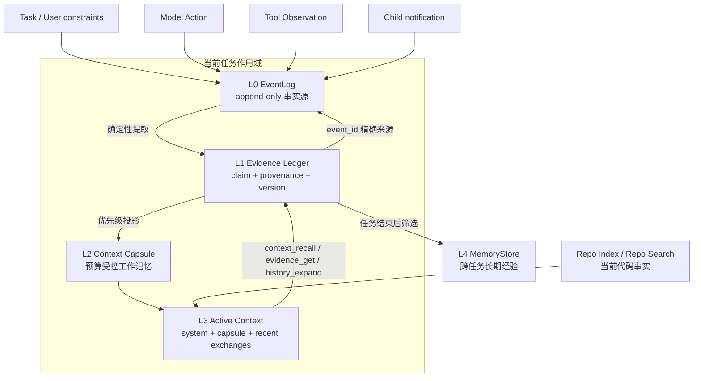
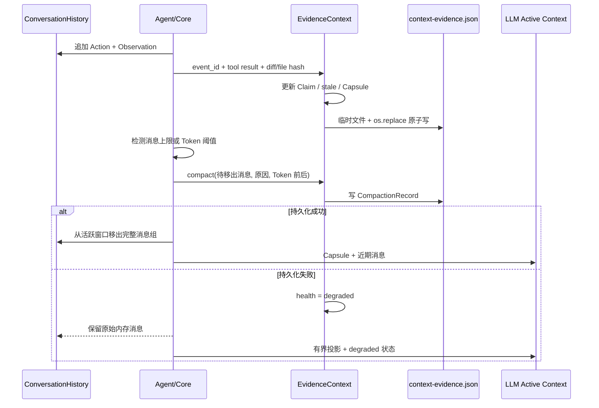

# Forge 证据保留型分层上下文架构详解

> 适用分支：`dev`
>
> 文档目标：既能作为实现说明，也能作为面试讲解材料。
> 诚实边界：本文只把已实现且有确定性测试覆盖的能力写成“已完成”；真实模型长任务的收益仍需后续 A/B 验证。

## 1. 一句话说明

Forge 不再把“被模型看不到的旧消息”等同于“可以遗忘的信息”。它把上下文拆成五层：原始事件是事实源，证据账本保存可追溯事实，Context Capsule 保存当前工作状态，模型只看到胶囊与近期消息，任务结束后才把精选经验写入长期记忆。

核心思想是：**上下文可以淘汰，证据不能失联；摘要可以帮助推理，但摘要不能取代事实源。**

## 2. 原上下文机制

改造前 Forge 已经不是完全无状态的 Agent：

- `ConversationHistory` 保存本轮与 Chat 多轮消息。
- `history_window` 超限后保留首条任务，删除最旧的后续消息。
- `TokenBudget.trim_history()` 在请求超过模型窗口时保留任务与最近消息。
- 原生 function calling 会把 assistant tool call 与 tool result 作为完整交换保留。
- `EventLog` 以 append-only JSONL 保存 Task、Action、Observation、Reflection 和完成事件。
- `RunContext` 保存阶段、近期相关路径、最近 12 条工具证据和测试状态。
- `MemoryStore/MemoryManager` 把任务结束后的经验保存到跨任务 SQLite。

原数据流大致如下：

```text
Task ──> ConversationHistory ──> 消息数裁剪 ──> Token 裁剪 ──> LLM
  │                                                        │
  └──────────────> EventLog <── Action/Observation <────────┘

RunContext: 仅保留近期轻量状态
MemoryStore: 任务结束后保存跨任务经验
```

这套机制能控制请求大小，也能事后审计，但“运行中的 Agent”无法精确找回已经被裁剪的证据。

## 3. 原方案会怎样失效

### 3.1 早期事实消失

Agent 在第 3 步读取配置文件，确认一个兼容约束；第 25 步上下文变长后，读取结果离开活跃窗口。模型仍记得“好像有个限制”，却不知道它来自哪个文件、哪一版内容。

### 3.2 失败方案被重复

第 6 步执行方案 A，测试报精确错误；消息被裁剪后，第 30 步模型只看到近期代码，可能再次执行方案 A。普通省略标记只能告诉模型“有内容丢了”，不能告诉它“丢的是哪次失败、如何恢复”。

### 3.3 测试通过结论过期

某个补丁下测试通过，随后文件再次修改。如果“测试通过”没有绑定当时的 diff，那么它会被错误地解释为“当前代码已经验证”。

### 3.4 子 Agent 摘要被过度信任

子 Agent 的总结属于报告，不是高可信事实。若父 Agent 只收到自由文本总结，却不能追溯 child artifact/EventLog，就无法区分“已运行测试”与“子 Agent 推测应该通过”。

## 4. 为什么三种常见方案都不够

### 4.1 只用滑动窗口

优点是简单、便宜；缺点是删除与信息价值无关。用户约束、失败测试和重复目录列表在算法眼里都是一条消息，无法保证高价值信息留下。

### 4.2 只扩大模型上下文

长上下文只是推迟溢出，并不能解决：

- 每一步输入成本持续增加。
- 大型工具输出会稀释注意力。
- 事实仍然没有版本与来源绑定。
- 子 Agent 与 Chat 会话最终仍可超过任何固定窗口。
- “模型曾经看到”不等于“模型当前能可靠定位”。

### 4.3 只让 LLM 自由总结

自由摘要可以压缩语义，但会引入三类风险：遗漏、幻觉和不可验证。摘要也无法自动知道文件是否已经变化。因此 Forge 第一版坚持结构化、确定性提取；LLM 摘要未来只能作为低可信补充，不能成为 L0 事实源。

## 5. 新架构总览



### 各层职责边界

| 层 | 保存什么 | 不保存什么 | 可信度 |
|---|---|---|---|
| L0 EventLog | 原始事件、工具结果、测试输出、event ID | 推断后的最终事实 | 观察事实源 |
| L1 Evidence Ledger | claim、来源、版本、状态、置信度 | 完整文件和完整日志副本 | 可回溯投影 |
| L2 Context Capsule | 目标、约束、阶段、当前事实、失败、测试、决策 | 全量 ledger/EventLog | 工作记忆 |
| L3 Active Context | Capsule、近期完整消息、系统指令、局部代码 | 全历史 | 本轮模型输入 |
| L4 MemoryStore | 任务结束后的精选经验 | 当前任务所有中间事件 | 跨任务参考 |
| Repo Index | 当前代码路径、符号、引用和图关系 | 任务历史与用户决策 | 代码检索源 |

`context_recall`、`memory_search`、`repo_search` 不是同一个工具的三个名字：

- `context_recall`：找当前任务以前发生过的事实和失败。
- `memory_search`：找以前任务积累的经验。
- `repo_search`：找当前仓库代码事实。

## 6. Evidence Ledger 数据结构

核心结构 `EvidenceClaim`：

```json
{
  "claim_id": "claim-4c98...",
  "statement": "Test failed: pytest tests/test_parser.py",
  "kind": "test_result",
  "status": "active",
  "confidence": 1.0,
  "source_event_ids": ["a31f...", "c901..."],
  "file_path": null,
  "symbol": null,
  "content_hash": "diff-sha256...",
  "git_revision": "base-commit...",
  "created_step": 6,
  "last_verified_step": 6,
  "invalidated_by": null,
  "metadata": {
    "validation_status": "failed",
    "diff_hash": "diff-sha256...",
    "command": "pytest tests/test_parser.py"
  }
}
```

### Claim 类型

- `user_constraint`：用户任务和独立约束，置信度 1.0。
- `code_fact`：文件读取等直接观察，绑定文件内容哈希。
- `test_result`：测试命令、状态、输出摘要与 diff hash。
- `decision`：实际发生的修改或框架决策。
- `failed_attempt`：失败工具、失败测试和完成门禁阻塞。
- `child_report`：子 Agent 报告，默认置信度 0.4。

### 确定性 ID 与去重

Claim ID 由类型、规范化陈述、路径、符号、内容哈希和首个来源事件做 SHA-256 派生。相同观察不会无限增加重复记录；新的文件版本或新的来源事件会形成可区分的 claim。

## 7. Context Capsule

Capsule 包含：

```text
task_goal / user_constraints / current_phase
confirmed_facts / hypotheses / rejected_approaches / open_questions
files_read / files_changed / test_results / decisions / next_actions
version / schema_version
```

它是增量更新的，不会每一步重新总结整个历史。列表主要存 claim ID，注入模型时再渲染短陈述。这样 ledger 可以很详细，而活跃上下文保持小而稳定。

渲染优先级：

1. 当前任务与用户约束。
2. 当前失败测试和阻塞。
3. 当前改动文件。
4. 最近验证结果。
5. active 的代码事实。
6. 已拒绝方案与原因。
7. 决策和下一步。

Capsule 有独立 Token 预算；若投影超限，会写明“可用恢复工具继续查询”，而不会把完整 ledger 塞进提示词。

## 8. 压缩前后数据流



### 原生工具调用对

assistant 的 `tool_calls` 与后续对应 `tool` 消息是不可分割组。消息数裁剪先识别整组，再调用 pre-eviction handler；Token 裁剪继续使用原有成组算法。因此不会产生“只有 tool result、没有 tool call”的非法历史。

### CompactionRecord

每次压缩记录：步骤、原因、前后 Token、移出消息数及哈希、来源 event ID、claim 引用、Capsule 版本、是否截断、是否成功持久化。

已实现触发包括：

- 消息数量上限。
- 软/压缩/硬 Token 比例。
- 单个大工具结果。
- 阶段切换。
- child 结果到达。
- finish 前。
- Chat checkpoint 前。

## 9. 版本绑定与 stale 机制

### 文件事实

读取文件时计算 SHA-256，并把它写入 `code_fact.content_hash`。文件编辑后，所有绑定旧内容哈希的 active claim 转为 stale；旧记录不会删除。

### 测试结果

测试 claim 保存命令、结果、输出摘要和测试时的 diff SHA-256。后续编辑若产生不同 diff，旧测试 claim 转为 stale。再次测试会生成当前版本的新 claim。

```text
read parser.py@hash-A ──> claim(active, hash-A)
          │
          └─ edit parser.py@hash-B
                 ├─ old claim -> stale
                 └─ new read -> new active claim(hash-B)

test passed@diff-X ── edit -> diff-Y ──> old test claim stale
                                      └─ rerun -> active test@diff-Y
```

因此，“曾经验证过”和“当前补丁已经验证”在数据上是两个不同状态。

## 10. 恢复工具

### `context_recall(query, limit, token_budget)`

按关键词、文件、类型和符号搜索当前任务 claim，返回分数、状态、置信度与来源 ID。它适合问：“之前 parser 的失败原因是什么？”

### `evidence_get(ids, token_budget, task_id?)`

根据 claim ID 或 event ID 精确展开。`task_id` 默认当前任务；只有已经登记的 child task 才能访问。

### `history_expand(step_start, step_end, token_budget, task_id?)`

按最多 50 步的有界范围恢复 EventLog。它不是“读取整个日志”的后门。

三者共同保证：

- 输出数量和 Token 有硬上限。
- 返回 `truncated` 与估算 Token。
- 重复查询有指标。
- stale 状态显式展示。
- 日志统一标为 `UNTRUSTED DATA`。
- 工具不接受任意文件路径。
- API Key、token、密码、私钥等会被清理。

## 11. Token 预算设计

配置示例：

```yaml
context:
  strategy: evidence_preserving
  soft_limit_ratio: 0.65
  compact_limit_ratio: 0.78
  hard_limit_ratio: 0.90
  capsule_token_budget: 1500
  recall_token_budget: 2000
  evidence_retention_steps: 100
  enable_history_expand: true
```

预算是分离的：模型窗口、输出保留、Repo overview、Capsule、单次 recall、局部 Repo-map 和整题运行 token 互不冒充。固定成本先扣除系统提示、工具 schema、历史记忆、Capsule 和输出 reserve，剩余空间才给近期消息。

`evidence_retention_steps` 控制较旧 code fact 是否继续进入 Capsule 投影，不删除 L0/L1。需要时仍可 recall。

## 12. Chat checkpoint 与崩溃恢复

Memory SQLite schema 从 v1 前向迁移到 v2，`session_checkpoints` 增加 `context_json`。老数据库自动 `ALTER TABLE`，老 checkpoint 对应空对象。

Chat checkpoint 保存：

- 有界 ConversationHistory。
- Capsule、Ledger、CompactionRecord 和查询指标。
- 轮数、Token、步骤统计。

checkpoint 内容不会加入跨任务 FTS，也不会被 `memory_search` 当作历史经验；它只是当前会话恢复状态。

## 13. 子 Agent 证据传递

父任务与子任务分别持有自己的 EventLog、ledger 和 Capsule。父 Agent 收到 child notification 后：

1. 保存 child task ID、状态和 artifact 引用。
2. 生成低置信度 `child_report`，不直接升级成代码事实。
3. 只允许 `evidence_get/history_expand` 访问已登记且位于当前日志根目录内的 child EventLog。
4. 父 Agent 读取文件或运行测试后，才生成父 scope 的高置信 claim。

worktree 回收不会抹掉结果 artifact、patch 和 EventLog 引用。当前实现没有自动把子 Agent 的自然语言总结拆成多个高可信事实，这是刻意保留的安全边界。

## 14. 安全设计

- EventLog 写入前做 secret-only redaction，保留诊断和指令文本原貌。
- Ledger、Capsule、checkpoint 和恢复输出复用更严格的 secret 与 prompt-injection 清理。
- 外部日志内容被标为不可信数据，不能作为工具指令执行。
- 当前任务工具通过线程本地绑定，父子 Agent 共用注册表时不会串 scope。
- child artifact 和 EventLog 必须位于允许的日志根目录。
- 文件哈希只接受 workspace 内路径，解析 symlink 后再次做 containment 校验。
- JSON 持久化采用同目录临时文件和原子替换。
- sidecar、SQLite、日志和本地配置都属于运行产物，不提交 Git。

## 15. 降级与兼容

`context.strategy: sliding_window` 保留旧行为，便于兼容和消融。`evidence_preserving` 的 sidecar 写入失败时：

- `health` 变为 `degraded`，记录不含敏感路径细节的原因。
- 消息数量裁剪的 pre-eviction handler 返回失败，原始内存消息不删除。
- Token 投影仍必须遵守模型窗口，但原始 History 和 EventLog 仍在，最终 artifact 报告 degraded。

系统不会静默退回 sliding window。

## 16. 可观测性

`RunResult.context` 与任务 artifact 记录：

- 压缩次数、每次原因和前后 Token。
- 移出消息数、Capsule 更新数和版本。
- claim 总数及 active/stale/invalidated 分布。
- recall 次数、重复次数和消耗 Token。
- 压缩后重复工具操作次数。
- 是否在压缩后进行恢复。
- evidence 保存失败与 degraded 原因。
- 最终优先 claim ID。
- 本次实际上下文配置。

这些字段也加入 A/B 评测的有效配置指纹，避免不同上下文策略误复用同一断点结果。

## 17. 实际编码任务示例

假设 Issue 是：“修复 CRLF 下的 patch 校验，但不得改变 `apply_patch` 的公开参数。”

1. TASK_START 生成 goal 与“不得改变公开参数”约束 claim。
2. Agent 用 Repo 检索定位 `workspace.py`，读取文件形成 `code_fact(hash-A)`。
3. 第一次修改后运行定向测试，失败为 `test_result(diff-X, failed)` 和 `failed_attempt`。
4. 消息变长触发压缩；原始测试输出离开 L3，但 claim、event ID 和失败状态仍在 L1/L2。
5. Agent 忘记错误细节时调用 `context_recall("CRLF assertion")`，再用 `evidence_get(event-id)` 精确展开。
6. 第二次编辑使 `code_fact(hash-A)` 和 `test_result(diff-X)` stale。
7. 重新读取生成 `code_fact(hash-B)`；重新测试生成 `test_result(diff-Y, passed)`。
8. finish 前记录 compaction/checkpoint，最终 MemoryStore 只保存解决方案、验证结果和有价值失败经验。

关键区别：模型可以忘记原文，但系统没有忘记证据在哪里、对应哪版代码。

## 18. 新旧方案对比

| 维度 | 旧 sliding window | evidence-preserving |
|---|---|---|
| 超限处理 | 删除旧消息/插入省略标记 | 先固化证据与压缩记录，再移出投影 |
| 来源追踪 | 事后人工翻 EventLog | claim 直接引用 event ID |
| 文件变化 | 旧事实仍像当前事实 | 内容哈希 + stale |
| 测试结论 | 未绑定补丁版本 | 命令 + 状态 + diff hash |
| 失败方案 | 可能被遗忘并重复 | failed_attempt 可 recall |
| 子 Agent | 摘要直接进入历史 | 低可信 child_report + artifact 来源 |
| 恢复 | 无运行时工具 | 三个只读、有界恢复工具 |
| checkpoint | 仅消息 | 消息 + Capsule + Ledger |
| 成本 | 实现简单、I/O 少 | 多一次有界 JSON 原子写与哈希 |

## 19. 技术选型理由

### 为什么第一版用 JSON sidecar，而不是 SQLite

当前任务最多约 40 步，claim 通常是几十到数百条。每任务一个 JSON：

- 可直接随 result artifact 审计和恢复。
- 无新依赖、无共享数据库锁竞争。
- 原子替换容易实现。
- 父子任务天然按目录隔离。

代价是查询与持久化接近 O(n)，超长任务 ledger 达到万级时不合适。届时可以在不改变工具契约的前提下迁移到 SQLite/JSONL 索引。

### 为什么不是向量数据库

第一版查询对象小，路径、命令、错误名和符号以词法匹配更可解释；向量库会增加依赖、模型费用、数据泄漏面和实验不可复现因素。未来可把 embedding 作为召回信号，但不能替代 event provenance。

### 为什么不重写 Agent 主循环

现有 ReAct、完成门禁、Repo 检索和工具系统已经稳定。实现通过 EventLog 返回 ID、RunContext 观察钩子、History pre-eviction handler 和三个工具完成连接，减少行为回归面。

## 20. 测试与验证

新增确定性测试覆盖：

- 裁剪记录、约束和失败测试保留。
- event ID 回溯与 step 范围恢复。
- 文件编辑后 code fact stale。
- 编辑后旧测试结论 stale、新验证生成新证据。
- Capsule 与恢复输出 Token 预算。
- 重复查询指标。
- 越权 task scope 拒绝。
- EventLog 与 ledger 的敏感信息清理。
- 原生工具调用对成组裁剪。
- 持久化失败时保留原消息。
- checkpoint v2 恢复 Capsule/Ledger。
- MockBackend 长任务中的压缩、恢复与完成。

实现阶段未调用付费模型。最终全量测试为 **537 passed、18 skipped**，耗时约 184 秒；跳过项是 Docker/平台条件测试，skip 不等价于失败，也不描述成已实际执行。

## 21. 当前限制

1. Claim 提取以结构化工具事件为主；还没有用离线语义模型从任意自然语言中抽取复杂因果链。
2. 非工具文本中的 hypothesis/open question 目前主要保留结构字段，自动填充较保守。
3. JSON sidecar 在万级 claim 超长任务上会有 O(n) 查询和重写成本，尚未做该规模压测。
4. Child 自由文本仍只作为低可信报告；父 Agent 不会自动验证每条子结论。
5. 词法 recall 对同义词能力有限。
6. 尚未运行真实 MiMo/其他模型的长上下文 A/B，因此不能声称 resolved rate 已提高。
7. EventLog 会对单字段做安全上限与凭据清理，所以它是“安全化的原始事件层”，不是逐字节 forensic 镜像。

## 22. 后续改进方向

- 用真实长任务测量“压缩后重复操作率”“首次恢复成功率”和 resolved rate。
- 为 claim 增加显式 supersedes/contradicts 图，而不仅是 stale。
- 当 ledger 达到阈值时迁移为 append-only JSONL + SQLite 索引。
- 引入可选、本地化的语义召回信号，并保留词法分数与 provenance。
- 把最终 answer 中引用的 claim 做显式引用校验。
- 对子 Agent artifact 增加签名/manifest 校验与更细粒度 delegation scope。
- 增加故障注入测试：磁盘满、进程崩溃、sidecar 部分写、child worktree 回收。

## 23. 两分钟面试口述稿

我在 Forge 里解决的不是简单的“上下文太长”，而是裁剪后证据失联的问题。原系统有 ConversationHistory、TokenBudget 和 EventLog，但旧消息被裁剪以后，Agent 虽然事后能翻日志，运行时却找不回早期约束、失败测试以及这些结论对应的代码版本。

我把上下文拆成五层。L0 是 append-only EventLog，作为事实源；L1 是 Evidence Ledger，用确定性规则从工具事件提取 claim，并保存 event ID、文件哈希、diff hash、置信度和 active/stale 状态；L2 是有独立 Token 预算的 Context Capsule，只保存目标、约束、当前事实、失败、测试和下一步；L3 是模型实际看到的 Capsule 加近期消息；L4 才是跨任务 MemoryStore。

裁剪前系统先更新 ledger 和 Capsule，原子写入 CompactionRecord，成功后才移出消息。文件修改会让绑定旧哈希的代码事实 stale，补丁变化也会让旧测试结论 stale。Agent 可以通过 context_recall、evidence_get 和 history_expand 按需恢复证据，输出有 Token 上限和 task scope，日志内容统一视为不可信数据。

实现没有重写 ReAct 主循环，只在 EventLog、RunContext、History 裁剪点和工具注册层加连接。旧 sliding window 仍可用于消融。确定性测试覆盖了压缩、恢复、stale、checkpoint、原生工具调用配对和敏感信息清理；真实模型收益我会用后续 A/B 验证，不会只凭架构推断。

## 24. 五到十分钟深入讲解提纲

### 第 1 分钟：问题定义

强调 Token 超限只是表象，真正问题是“高价值证据与来源、版本、失败因果断开”。举失败测试被裁剪后重复方案的例子。

### 第 2～3 分钟：分层与边界

从 L0 讲到 L4，说明 EventLog 是事实源、Ledger 是索引、Capsule 是工作记忆、MemoryStore 是跨任务经验，Repo Index 则是代码事实检索。重点解释为什么三类 search 不能混。

### 第 3～4 分钟：压缩事务

讲 pre-eviction handler 和 Token projection：识别完整消息组，保证证据已经存在，原子写 CompactionRecord，成功后裁剪；失败则保留 raw history 并 degraded。说明原生 tool-call/result 不能拆开。

### 第 4～5 分钟：版本与可信度

讲 file hash、diff hash、active/stale、test binding。强调 child summary 默认 0.4 置信度，父 Agent 验证后才形成高可信事实。

### 第 5～6 分钟：恢复与安全

讲三个工具的范围、Token 上限、重复查询和 UNTRUSTED DATA。解释为什么不允许模型传任意日志路径，以及凭据在 EventLog 写入前也会清理。

### 第 6～7 分钟：兼容与工程权衡

说明没有重写主循环、保留 sliding_window、SQLite checkpoint v2 前向迁移。解释选择 JSON sidecar 的任务规模假设和未来迁移条件。

### 第 7～8 分钟：验证和诚实边界

说明 MockBackend 的确定性集成测试能证明机制正确，但不能证明真实 SWE-bench resolved rate 提升；后者需要冻结任务集、相同模型和官方 Docker 的 A/B。

## 25. 面试官可能追问与建议回答

### Q1：EventLog 已经有全部内容，为什么还要 Ledger？

EventLog 适合审计，不适合每轮全量扫描和注入。Ledger 是有 schema 的索引，能按 claim、路径、错误和版本检索；它引用 EventLog，而不是复制或取代 EventLog。

### Q2：Ledger 提取错了怎么办？

第一版只对工具执行、文件哈希、测试状态、用户约束等确定性信号给高置信度。自由文本和 child report 置信度低。每个 claim 有 event ID，可展开原始来源；错误 claim 可以 invalidated，而不是覆盖历史。

### Q3：为什么文件修改后不直接删除旧 claim？

旧 claim 仍有审计和因果价值，例如解释为什么之前选择了某方案。stale 表示它不再是当前事实，但保留历史证据。

### Q4：Context Capsule 会不会也产生信息损失？

会，所以 Capsule 不是事实源。它只是预算受控投影；缺失信息可以通过 claim ID 或范围查询从 Ledger/EventLog 恢复。

### Q5：怎样避免恢复工具把整个日志重新塞回上下文？

工具对 IDs、step 范围、结果数量和 Token 都有限制，history_expand 最多 50 步；超限显式标记 truncated。模型必须逐步检索。

### Q6：JSON 每次重写性能好吗？

对当前 40 步、百级 claim 的任务足够，换来可审计和低复杂度。它不是万级事件的最终方案；指标达到阈值后会改 append-only 存储和索引，但工具接口不变。

### Q7：为什么不用向量数据库？

当前证据多是路径、命令、异常和符号，词法检索可解释且无额外模型成本。向量可以作为未来的召回信号，但不能替代版本绑定和 provenance。

### Q8：如何证明不会泄漏 API Key？

EventLog 使用 secret-only redaction；Ledger、checkpoint 和恢复输出使用更严格清理；有自动测试把模拟 key 写入任务并断言磁盘与返回结果中不存在原值。仍需在生产中补充更多厂商凭据模式和安全审计。

### Q9：怎样衡量它真的有效？

机制层看 compaction 后重复操作、recall 成功、stale 误用、Token 与延迟；能力层用冻结任务、同模型同预算对比 resolved rate。小样本只能说明方向，不能做总体排名。

### Q10：这个设计最重要的工程原则是什么？

把“模型当前看到什么”和“系统知道什么”分开；模型上下文可以有损，系统证据链必须可定位、可验证、可失效。
