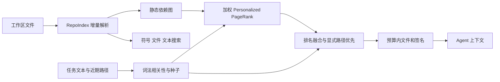

# Forge 框架修复与 Repo-map 升级

日期：2026-10-29。修复基线：`dev / 56c3a55`。保留现有 ReAct 主循环，修复运行服务之间的契约，将默认地图升级为任务相关的 Personalized PageRank。

## 1. 备份与变更范围

修改前备份：`D:\fianll-test\forge-backups\framework-upgrade-20261029-160955`。

- `before.bundle`：修改前的 Git 引用与历史。
- `workspace.zip`：受版本控制及未忽略的新文件，包含先前分析文档；不复制被忽略的密钥和日志。
- 清单记录基线与 ZIP 指纹：`3728e360cc853d6a53ce637c0fdd0344a7bf6b58faa3be09305a3af7799c2bf7`。

原有完整项目备份保留。代码继续在 `dev` 开发，尚未合并到 `main`。

## 2. 框架修复对照

| 范围 | 现在的行为 | 主要实现 |
| --- | --- | --- |
| 执行与传输 | Git 使用 argv；辅助 Python、文件内容和补丁通过 stdin，避免 Windows 命令行长度限制与参数解释 | `tools/runtime.py`、各工具 |
| 补丁换行 | 辅助进程通过 JSON 转义传输 patch，避免 Windows 文本输出把 hunk 内 CRLF 重复转换 | `agent/core.py` |
| 任务权限 | 注册表同时过滤 schema 和执行；只读任务拒绝写入、Shell、测试和 fork；子任务权限不能升级 | `tools/base.py`、`multi_agent/sub_agent.py` |
| 确认覆盖 | 文件修改、test.command、Git 写入与 Shell 共用确认回调；解释器、pytest、复合命令及明显带写选项的命令不享受只读豁免 | `tools/base.py`、`tools/shell_tool.py` |
| 文件边界 | 保留内部符号链接；绑定 Runtime 的文件写入目标必须解析到工作区内部 | `tools/file_ops.py`、`tools/file_tool.py` |
| 完成门禁 | 保留新 diff + 最后修改后定向测试尝试门禁；运行状态与验证状态分开记录 | `agent/core.py`、`agent/task.py` |
| 失败产物 | 完成、步数/预算耗尽、取消、模型错误、异常、Ctrl+C 都经过统一保存；保存失败保留子 worktree | `agent/run_context.py`、`multi_agent/sub_agent.py` |
| 子任务交付 | 返回 base、状态、摘要、产物引用及 patch 预览；父子任务共用配置的日志/产物目录，父任务可按任务 ID 应用原始 patch，无需模型重新抄写 | `entry/cli.py`、`tools/task_tool.py`、`tools/file_tool.py` |
| 共享累计预算 | 父子请求共用线程安全账本，发送前预留、返回后按 usage 结算；重复通知不重复计费 | `agent/run_context.py` |
| 终止顺序 | 父退出时关闭新请求入口，先通知全部子任务，再按一个总等待期限回收；取消期间返回的 Action 不执行 | Agent、TaskRegistry、SubAgent |
| 工具消息 | 保留调用 ID 与 assistant.tool_calls/tool 结果；OpenAI/Anthropic 分别转换；按完整调用/结果组裁剪 | `llm/`、`context/` |
| 工作记忆 | 每轮保留近期路径、阶段、工具证据、测试结果与子产物引用；只读探索不再被催促编辑 | `agent/run_context.py`、`agent/core.py` |
| GitHub 入口 | 拒绝脏/无效 checkout；认证只通过进程级配置提供，clone URL 不含 Token；分支切换失败不继续 | `entry/github_issue.py` |
| 配置与评测 | 显式路径错误立即失败；接通 Shell/FileView/map 配置与范围校验；数据集使用 v2 规范化 JSON 指纹 | `config/`、`evaluation/` |

确认分类是交互策略。只读任务直接禁用 Shell/测试，不依靠命令名分类来保证只读。运行不可信源码仍使用 Docker Runtime。

`status=success` 表示 Agent 通过完成门禁正常结束，定向测试仍可能失败。应同时查看 `validation_status`；SWE-bench 是否 solved 仍由绑定该 patch 的官方 harness 判断。

## 3. 新地图的结构与算法



- **RepoIndex**（`context/repo_index.py`）：Git 枚举使用 `git ls-files --cached --others --exclude-standard`，包括未跟踪的有效新源码。非 Git 目录提供嵌套忽略规则回退。跳过虚拟环境、仓库外链接；超过 500 KB 的文件保留路径元信息。
- **图**：Python AST 提取普通/异步函数、类、限定方法名、签名、绝对/相对导入及引用。边从引用方指向依赖方；导入是强边，唯一名称匹配提供弱边。重复同名定义不当作确定引用。这是保守的文件依赖近似，不是完整类型分析或运行时调用图。
- **PageRank**（`context/graph_rank.py`）：确定性的加权实现，默认阻尼 0.85，处理孤立与 dangling 节点，无需 NetworkX。
- **选择**（`context/map_builder.py`）：IDF 加权词法相关性、明确路径和近期读取/搜索路径生成种子；个性化图排名与词法排名做倒数排名融合，明确指定的路径优先保留。
- **渲染**：先展示少量相关签名，再用剩余预算补充。大块放不下时缩短或跳过，不停止整张地图。新版三种策略按 `estimate_tokens` 约束；`legacy` 保留原字符预算，探针单独报告是否超出估算 token 预算。
- **刷新**：文件集合与内容指纹决定版本，只重新解析改变的源码。选择缓存还包含任务、近期路径、预算和算法，新增/删除/重命名与跨轮任务均能更新；日志与当前产物目录排除。增量缓存减少 AST 解析，但仍会枚举和读取源码计算指纹。

运行中的 `find_symbol`、`find_files`、`search_text` 共享索引的文件集合；符号搜索支持 `Worker.run` 和异步方法，文本内容仍通过任务 Runtime 搜索。独立实例化旧搜索工具时保留兼容回退。

## 4. 配置与产物使用

```yaml
agent:
  max_steps: 40
  run_token_limit: 80000
context:
  context_window: 32768
  repo_map_budget: 4000
  repo_map_strategy: personalized
  history_window: 20
```

`run_token_limit` 兼容旧名 `budget_tokens`，同时提供时新名优先。累计预算包括每次重复输入，不是最终窗口大小；80,000 token 不保证能走完 40 步。窗口、输出上限和总预算分别设置。

有效日志目录下每次运行保存 `artifacts/<task_id>/result.json`，包含状态、base、验证、日志位置、工作记忆与预算快照；有修改时另存 `changes.patch`，包括未完成修改。

`apply_patch` 新增 `{"artifact_task_id":"子任务ID"}`，只从配置的产物目录读取，校验 patch 的 SHA-256，再执行 `git apply --check` 和应用。冲突不自动合并，父任务仍需分析并测试。原 `{"patch":"..."}` 接口保留。

保存失败时，子任务返回 `artifact_error` 和 `recovery_worktree`，保留唯一的工作副本。模型请求尚未结算时父结果标记 `usage_complete=false`，预算快照保留 pending/reserved 数量。网络失败且服务端未返回 usage 时仍无法确认是否计费，因此不是账单级硬上限；Python 线程也不能安全强杀等待中的 SDK 调用。

## 5. 验证记录

主体改动的全量回归：**486 passed，18 skipped，136.78 秒**（`logs/framework-final-tests.txt`）。最后复核补充了自定义日志目录的子任务产物交付修复：新增回归先复现旧行为找不到产物的问题，修复后包含该用例的相关测试为 **66 passed，1 skipped，38.78 秒**。跳过项涉及 Docker 不可用及 Windows 平台能力。`git diff --check` 通过，wheel 构建通过，检查安装包包含新增模块且没有本地密钥配置或真实 Key；冻结 30 题也通过本机与 Git LF 数据指纹一致性检查。

主要新增回归覆盖长 Unicode stdin、字面量 Git 参数、权限与确认、失败 patch 清理后应用、校验篡改、保存失败保留 worktree、请求中取消、父子记账、原生消息配对、索引与搜索一致性、地图缓存与预算、语义指纹。

真实在线协议冒烟：Flash / Pro 均两步完成“file_view 读取随机值 → tool result 回传 → finish”，分别使用 **1,712 / 1,599 token**。这是协议测试，没有在 Linux 中执行项目修复。证据：`logs/framework-protocol-smoke/summary.json`。

默认流式路径也重复验证通过：Flash / Pro 均为两步，分别使用 **1,771 / 1,691 token**。证据：`logs/framework-protocol-stream/summary.json`。两组小请求不能用于模型能力排名。

Docker Desktop 4.77.0 当前启动失败，backend 日志报告 Inference manager 的 `dockerInference` socket 创建/删除错误，引擎不响应。未重置或删除 Docker 数据；真实 Docker 合同测试跳过。已加入 25,000 / 100,000 单位 Unicode 内容及字面量 Git 参数的容器用例，恢复引擎后运行：

```bash
python -m pytest tests/test_docker_contract.py tests/test_sandbox.py -q
python -m evaluation.smoke_agent
```

## 6. 离线对比与消融入口

探针不调用模型；`--expected` 只用于评分，不进入地图查询：

```bash
python -m evaluation.repo_map_probe --repo . --task "Fix native tool result message history and preserve unfinished child changes" --expected agent/core.py --expected llm/openai_compat.py --expected multi_agent/sub_agent.py --budget 4000 --output logs/framework-map-comparison.json
```

在本轮工作区快照、上述单条人工标注查询中：

| 策略 | 估算 token | 首个标注文件排名 | Recall@5 |
| --- | ---: | ---: | ---: |
| 原版 legacy | 3938 | 8 | 0/3 |
| 纯词法 lexical | 3999 | 5 | 1/3 |
| 全局 PageRank global | 3996 | 2 | 1/3 |
| 个性化融合 personalized | 3998 | 1 | 2/3 |

这是检索代理指标，该查询与本仓库改动相关且由人工选定，不能估计普遍收益或修复率。源码/文档变化后数值可能改变。各策略独立构建索引，本机冷启动约 2～3 秒，尚未做大仓库性能基准。

原冻结 30 题未重新抽样，Flash/Pro 配对顺序和官方验证链路保留。manifest 仅迁移语义哈希 v2。A/B 新增 `--map-strategy`、`--repo-map-budget`，并记录有效窗口、地图参数、工具配置、接口与源码指纹；配置改变拒绝沿用旧结果。

建议先固定模型比较地图，再固定地图比较模型，每组使用新目录：

```bash
python -m evaluation.run_ab --config config/mimo.local.yaml --map-strategy personalized --repo-map-budget 4000 --output evaluation/runs/framework-ppr
```

本轮没有完成 30 题真实消融，没有声称 PageRank 提升 resolved rate。

## 7. 仍需后续改进

- Python 图最完整；其他语言仍以 tree-sitter/正则定义抽取为主。动态导入、重导出、继承分派和装饰器可能漏边。
- 非 Git 目录忽略规则为实用回退，并非完整 Git ignore 语法；Git 仓库使用 Git 本身的规则。
- 轻量阶段与证据记忆不等于自动证明假设，也不支持跨进程恢复正在执行的 Agent。
- 只读 review 不在用户源码目录运行 linter/测试；后续可加入临时工作区中的独立执行能力。
- Token 估算和检索权重需在独立开发集调参，再用固定评估集验证，不能根据单条查询认定新默认必然更优。
