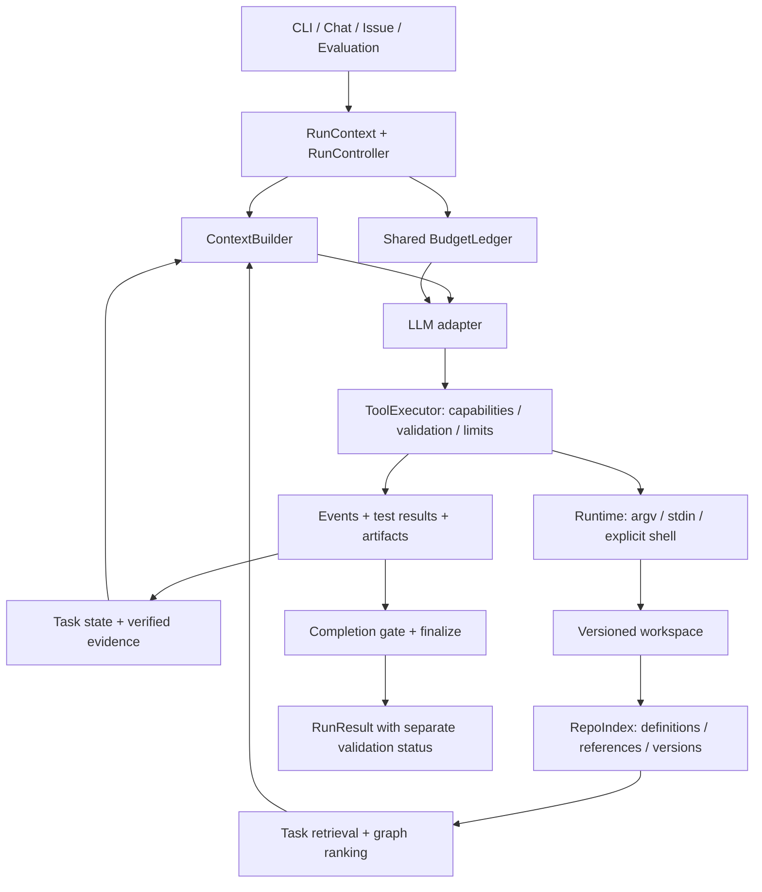

# Forge Agent：Repo-map、PageRank 与整体架构分析

> 本文为升级前的设计分析。已实施内容、当前边界与运行方式见 [框架与 repo-map 升级记录](framework-repo-map-upgrade-2026-10-29.md)。

分析日期：2026-10-29。源码基线：`dev` / `56c3a55`。本次分析结合项目讲解 `forge部分/study/agent-hybrid-analysis.md`、当前实现、临时目录复现和开源项目原始资料。

本文提出设计与修复建议，没有修改业务代码，没有运行付费模型实验，没有提交或推送。上一轮具体缺陷及复现见 [全面复查报告](comprehensive-review-2026-10-28.md)。

## 1. 核心判断

**值得升级 Repo-map，但应该升级为“任务相关检索 + 引用图 + Personalized PageRank + 符号级预算裁剪”，而不只是替换排序公式。**

当前 Repo-map 的确存在明显的信息选择问题，已经在 Forge 自己的仓库上观察到核心循环文件被排到末尾。但这不能证明 PageRank 一定提高最终解题率，也不能证明之前效果不好主要由 MiMo 引起。模型能力、执行可靠性、上下文选择和评测环境，需要分别验证。

**整体技术路线可以保留。** 手写 ReAct 循环、模型适配层、工具注册表、Runtime、Repo-map 与子 Agent 并不冲突。当前更严重的问题是这些模块之间缺少一致的运行契约：工具权限、预算、仓库状态、上下文版本、子任务产物和完成状态，各自有实现，却没有始终使用同一份事实。

本项目适合继续建设成一个可解释、可测量的编程 Agent 执行系统。目前没有证据支持必须重写成 LangGraph，或者增加更多 Agent。

## 2. 当前 Repo-map 的实际表现

### 2.1 目前的实现是什么

代码位置：[评分](../context/repo_map.py#L212)、[构建与截断](../context/repo_map.py#L263)、[扫描](../context/repo_map.py#L304)。

现在的流程是：

```text
遍历文件 → 提取函数/类定义 → 给整个文件打分 → 拼接整个文件的符号列表 → 按字符预算停止
```

评分公式：

```text
score(file) = 顶层定义数量 - 文件字节数 / 10000
```

这属于文件定义目录的启发式压缩，还没有形成代码关系图：

- 没有提取引用关系，没有识别文件间依赖。
- `build()` 没有接收任务描述、问题涉及的符号或失败堆栈。
- 只输出名称、种类和行号，没有函数签名和所属类等完整限定信息。
- 一个类即使承载整个执行核心，也只贡献一个顶层定义；其中方法不会增加这个分数。

### 2.2 在当前 Forge 仓库上的实测

本机工作区扫描耗时约 2.47 秒，得到 1,124 个文件、1,156 个符号。文件数包含当前工作区中的日志和其他未忽略产物，并非 Git 跟踪文件数；后续产物增加会改变具体名次。

| 文件 | 当前排名 | 分数 | 含义 |
|---|---:|---:|---|
| `tests/test_day2.py` | 1 | 15.147 | 大量顶层测试辅助定义得到高分 |
| `tests/test_day3.py` | 2 | 14.988 | 同上 |
| `tests/test_day1.py` | 3 | 14.521 | 同上 |
| `entry/cli.py` | 4 | 14.084 | 入口确实有价值，但排序依据仍是数量 |
| `context/repo_map.py` | 17 | 6.872 | 定义数量相对较多 |
| `tools/runtime.py` | 36 | 4.010 | Runtime 在默认地图中出现 |
| `multi_agent/sub_agent.py` | 66 | 0.591 | 默认地图未覆盖 |
| `agent/core.py` | **945** | **-1.986** | 核心循环被排在大量普通小文件之后 |

`agent/core.py` 为 39,859 字节，提取出 13 个符号，但只有 `AgentConfig` 和 `Agent` 两个顶层定义，所以分数为：

```text
2 - 39859 / 10000 = -1.9859
```

文件中的说明注释会增加字节惩罚，却不会减少架构重要性。这个例子直接说明，当前分数不适合作为“文件对任务有多重要”的近似。

按目前 Agent 默认计划分配的 10,200 Token 地图预算，实际展示 39 个文件，其中 17 个来自 `tests/`，没有包含 `agent/core.py`；文本估算为 10,198 Token。

测试文件不是应当排除的噪声：修复失败测试时，它们可能最重要。这里的问题是排序不看任务，因此分析执行循环和修复测试，得到的是同一份文件选择。

### 2.3 三项已复现的附加问题

**A. 大块放不下时，整个地图提前结束。**

构造一个有 100 个顶层函数的 `a_many.py`，再放一个很小的 `b_target.py`，执行 `build(budget=100)`，实际结果只有：

```text
... (2 more files not shown)
```

原因是遇到第一个放不下的文件后直接 `break`。后续能放下的文件没有机会进入地图，当前文件也不会降级为“文件名 + 关键签名”。

**B. 不遵循 `.gitignore`。**

临时目录设置 `.gitignore` 忽略 `ignored/` 后，`ignored/noise.py` 仍进入 `_scan()`。真实项目的 `logs/` 和本地配置虽被 Git 忽略，也不会因此被 Repo-map 排除。当前摘要不会直接输出 YAML 密钥内容，本项确认的是扫描边界和上下文噪声问题。

`rglob()` 还会先遍历被忽略目录，再过滤其结果，不能实现真正的目录剪枝。大仓库冷启动成本主要可能来自枚举和解析，而不是 PageRank 迭代。

**C. 同路径缓存不随内容更新。**

代码位置：[缓存键](../agent/core.py#L198)、[首次构建后复用](../agent/core.py#L573)。

使用同一个 Agent，两次分析同一路径：第一次文件定义 `original()`，第二次在磁盘改成 `newly_added()`。第二次缓存仍含 `original`，不含 `newly_added`。当前缓存键只比较仓库路径，没有比较内容版本。

这会影响聊天模式连续任务，也会让一次运行内编辑后的符号和行号逐渐失真。增加任务相关 PageRank 后，还必须把“解析缓存”与“本次任务排序缓存”分开。

## 3. Aider 的 PageRank 真正解决了什么

本次核对了 [Aider 的 `repomap.py`](https://github.com/Aider-AI/aider/blob/main/aider/repomap.py)。重点是 `get_ranked_tags()` 和 `get_ranked_tags_map_uncached()`。远程 `main` 会变化；本次原文快照 SHA-256 为 `A5D4BEFE70445114B9F62DA47B0EEB2A5384F9E84A0C083C77A4B339CAF61ECD`。

Aider 当前流程中与本项目最相关的内容是：

1. 收集定义标签和引用标签，得到“哪个文件定义某符号，哪些文件使用它”。
2. 建立文件间的有向多重图，基本方向是“引用文件 → 定义文件”，边上保留符号与权重。
3. 使用当前聊天文件、明确提及的文件和标识符影响 personalization 或边权。
4. 对常见名称、引用频次和其他信号加权，避免频次直接支配结果。
5. 运行加权 PageRank，再把节点分数沿引用边分配给具体定义，排序粒度深入到符号。
6. 根据模型 Token 计数选择可展示的符号，并渲染相关代码结构，而非仅拼接完整文件列表。

因此，Aider 值得借鉴的是“图如何构建、任务如何参与、如何选择符号、如何控制预算”这一整套流程。只往当前 `importance_score()` 中加入一次 `nx.pagerank()`，并没有足够的数据可供算法使用。

### 3.1 为什么可能更好

假设 `api.py` 使用 `service.py`，而多个服务又使用 `parser.py`。引用图能发现 `parser.py` 承担公共能力，而无需它有很多顶层函数。重要文件对它的引用也会传递一部分重要性。

对于跨模块问题，图还能从任务明确指向的文件扩展到相关定义，降低只依赖关键词时漏掉间接依赖的概率。

### 3.2 为什么全局 PageRank 仍可能选错

全局中心性回答“仓库中谁被依赖得更多”，任务检索回答“这次问题需要谁”。两者有联系，但不相同：

- 一个只被调用一次的边界处理函数，可能正是漏洞所在。
- 公共工具、日志或基础类型可能非常中心，却与当前修复无关。
- 新文件、入口、配置文件和没有显式引用的测试，可能排名偏低。
- 动态导入、继承、多态、装饰器和同名方法会造成不完整或错误的引用边。
- 简单按名称连接所有 `run`、`get`、`test`，会制造大量伪关系。

**推荐 Personalized PageRank，并保留精确路径、堆栈和词法检索的独立入口。** 图用于补充关联信息，不应拥有否决任务明确证据的权力。

## 4. 适合 Forge 的 Repo-map 升级方案

### 4.1 先分清四个职责

无需马上引入四套复杂服务，可以先在 `context/` 中用小模块明确边界：

| 职责 | 输入 | 输出 | 缓存边界 |
|---|---|---|---|
| RepoIndex | 文件清单、内容版本、语言 | 定义、引用、导入、限定名、位置 | 按文件内容增量缓存 |
| TaskRetriever | 任务、堆栈、当前发现 | 候选文件与符号、命中理由 | 按任务与当前证据更新 |
| GraphRanker | 引用图、任务种子 | 文件/符号排序 | 图结构可复用，个性化排序单独缓存 |
| ContextBuilder | 排序、已读内容、Token 限额 | 本轮实际注入的上下文 | 按选择版本缓存 |

`RepoMap.build()` 最终可以变成这些步骤的薄封装，避免在一个函数中同时负责遍历、解析、排序和截断。

### 4.2 文件枚举与语言支持

- Git 仓库优先使用 `git ls-files -z --cached --others --exclude-standard`，去重后处理仍存在的文件，兼顾受跟踪文件与未被忽略的新文件。
- 非 Git 仓库使用真正支持忽略规则和目录剪枝的遍历。
- 明确生成文件、vendor、大型数据和二进制策略；大文件可以保留路径元信息，不能因为超过阈值就让 Agent 误认为文件不存在。
- 用当前 SWE-bench 任务涉及的 Python 先做可靠版本，再扩展 JS/TS。不要同时承诺所有语言都有同等级引用精度。
- 提取 `qualified_name`、所属类/作用域、签名、定义位置、导入和引用；分别标记解析成功、降级和部分解析。
- 地图使用仓库相对 POSIX 路径。当前 Windows 下的 `str(Path)` 会生成反斜杠，而实际工具在 Linux 容器执行。
- Repo-map 与 `find_symbol` 共用索引。当前后者仍是 Python 定义正则搜索，和地图宣称的多语言能力不一致。

### 4.3 图如何建立

第一版建议用**文件为节点、引用关系为有向边**，边上记录具体符号。这样比直接做全部 AST 节点的图更容易调试。

```text
caller.py --[引用 Parser.parse]--> parser.py
```

Python 优先结合导入、别名和模块路径解析关系。无法消歧的名称降低置信度；不要把所有同名定义都当成准确调用目标。符号定义图、运行时调用图和静态近似引用图应明确区分。

边权可以从以下可解释信号开始，但系数必须通过实验确定：

- 明确导入/限定引用高于只有名称匹配的引用。
- 重复次数使用 `log(1 + n)` 等次线性变换。
- 定义歧义多的符号降低权重，常见名称不能形成巨大权重。
- 当前任务明确提及的符号可以加权。
- 测试引用保留，因为测试提供行为契约；不宜统一删除测试边。

核心图可使用 caller → callee；查找调用方与相关测试时另外使用反向邻接检索。不要一开始把所有边直接变成无向边，否则会失去关系含义并放大通用节点噪声。

### 4.4 任务种子与个性化排名

种子信号建议按可靠性处理：

1. 用户或 Issue 明确给出的现存路径、堆栈位置、失败测试节点。
2. 明确符号名、异常类型、错误文本的检索命中。
3. 模型本轮已确认相关的文件、当前修改文件。
4. 任务描述和路径/签名的词法相关性。

使用带少量均匀平滑的个性化分布，避免完全困在初始候选中。采用以下定义时，`P` 的每一行表示一个文件向其依赖文件转移的概率：

```text
r = (1 - alpha) * p_task + alpha * P^T * r
```

`alpha=0.85` 可以作为常见起点，不能当作已验证最优值。孤立节点、没有出边的节点、空图和迭代不收敛都需要明确行为和确定性的降级排序。

**任务明确命中的文件要保底进入候选。** 即使个性化 PageRank 从该节点流向了依赖，也不能把原始堆栈文件挤掉。

第一版建议用排序融合，例如词法排名与图排名的 RRF，而不是直接相加量纲不同的原始分数。保底候选先处理，再根据相关性、重复度与实际 Token 成本选择其余片段。权重必须记录并可复现实验。

### 4.5 输出单位与预算

从“整个文件的全部符号”改成：

```text
文件路径
  类/函数限定名 + 签名 + 当前版本行号
  必要时附少量相邻源码
```

对一个较大的相关文件，可先保留路径、类名和命中的方法；放不下时缩小片段、降为签名或继续尝试其他候选，不得直接终止地图。

所有文件头、分隔符和截断提示都计入 Token。使用目标模型可用的 tokenizer 或标明误差的估算器，最后再对整份请求验算。不要把字符数乘除四当成严格上限。

先实验较小的地图预算，例如 1K、2K、4K，并与当前实际约 10.2K 的方案对比。这些是实验点，不是建议未经验证就把默认值设成某一个。索引本身可以完整，注入给模型的摘要应随任务选择。

### 4.6 更新策略

分开保存三个版本：

- 文件解析版本：内容摘要 + 解析器/语言查询版本。
- 图版本：定义、引用、导入发生变化后的索引版本。
- 上下文选择版本：图版本 + 任务种子 + 地图预算 + 选择策略版本。

已知编辑、补丁、子任务合并后标记变更文件失效；Shell 也可能修改文件，需要在适当边界检查仓库变化。不能只依赖文件工具回调。

优先增量重解析和重新排序，不必每一步扫描全仓。为缓存节省开销，也要允许按文件内容摘要识别重命名、删除以及快速连续编辑。

## 5. 借鉴多个项目，是否导致了架构问题

### 5.1 先区分 Open SWE 与 SWE-agent

你的讲解文档写的是 **SWE-agent 的 ReAct + Aider Repo-map**。当前代码是自己实现的 ReAct 循环，依赖中没有 LangGraph。这次提到的 **Open SWE** 如果指 [langchain-ai/open-swe](https://github.com/langchain-ai/open-swe)，它是另一个项目。

Open SWE 当前官方 README 描述的是 Deep Agents 基础能力、LangGraph 持久执行与线程状态，以及线程对应的 Linux 沙箱。本项目可以借鉴这些思想，而不采用同一框架；但使用 ReAct 并不意味着自动具备持久执行、检查点恢复和完整线程生命周期。

OpenHands 当前官方仓库也存在版本演进和职责拆分，Agent/工具/会话/工作区/事件等核心能力由其 SDK 等仓库承担。因此，不能只凭“借鉴 OpenHands”就认定 Forge 已继承它的整个运行语义。本文不推断具体代码的来源或复制关系。

### 5.2 三类思想的组合是合理的

| 思想 | 在 Forge 中适合承担的职责 | 衔接时必须明确的契约 |
|---|---|---|
| SWE-agent / Open SWE 的任务执行思想 | 多步决策、任务状态、验证、生命周期 | 当前处于什么阶段，何时终止，失败如何恢复 |
| Aider 的仓库地图思想 | 在有限上下文中选择与任务相关的代码 | 索引对应哪个版本，什么内容入选，花了多少 Token |
| OpenHands 的运行环境与事件思想 | 工作区、命令执行、状态观察、会话追踪 | 命令在哪执行，具有什么能力，事件与结果如何对应 |

问题不在于来源多，而在于原项目的默认前提不同：交互式结对开发可能有用户持续纠偏；自主修复需要执行器自己兜住权限、验证和退出；并发子任务还需要额外的预算与产物协议。

## 6. 当前框架最需要处理的衔接问题

### 6.1 执行抽象太偏向 Shell 字符串

代码位置：[Runtime.exec](../tools/runtime.py#L73)、[Docker 执行](../tools/runtime.py#L282)。

当前中心接口是 `exec(cmd: str)`。结构化 Git 参数、文件工具数据和任意 Shell 命令最终容易被压成同一种字符串，这同时产生了正确性、安全性和平台长度问题。

上一轮已复现 Windows → Docker 的 25 KB 文件传输失败，以及 Git 提交说明被当成 Shell 执行。换更强模型和加入 PageRank 都无法修复这类确定性执行错误。

建议先补 `exec_argv(argv, stdin, cwd, timeout)`，保留明确命名的 Shell 执行入口。结构化工具优先走参数数组，业务数据用 stdin/文件通道；执行权限、超时和输出策略经过同一个边界。

### 6.2 任务类型、权限和工具能力没有统一

主任务 `read_only` 目前主要改变提示和完成门禁，没有在执行层收窄能力。`test.command` 又能绕开 Shell 的确认回调。具体复现见上一轮 R03/R04。

建议在 RunContext 中明确能力集合，工具展示和实际执行都做校验，子任务只能继承或收窄。Shell、测试、Git 不能各自解释同一个任务的权限。需要测试副作用的只读分析，应通过明确的临时工作区策略处理。

### 6.3 单次上下文与整次运行预算混用

代码位置：[上下文预算初始化](../agent/core.py#L223)、[累计预算停止](../agent/core.py#L241)、[预算分配](../context/token_budget.py#L196)。

同一个 `budget_tokens=80000` 同时用于：

- 分配每次模型请求的上下文空间。
- 限制整个运行中各次请求累计的输入 + 输出 Token。

默认先预留 15%，再拿剩余空间的 15% 给 Repo-map，所以实际地图预算是：

```text
80000 × 0.85 × 0.15 = 10200
```

这和配置里写的 `context.repo_map_budget=8000` 并不一致；该配置目前没有控制这里的选择。

在本次工作区的地图规模下，仅地图本身约八次请求就会累计八万输入 Token，尚未计算提示、任务、历史、工具 schema 和输出。配置允许 40 步，不代表总预算支持实际走到 40 步。这是预算定义问题，不能直接归因于模型不会修复。

建议至少拆分：`context_window`、`max_output_tokens`、`run_token_limit`，并为多 Agent 使用共享 BudgetLedger。缓存输入的计费折扣应另外记录，不能与上下文占用或 Token 总量混为一谈。父任务还必须纳入子任务消耗，见 R06。

### 6.4 上下文只有裁剪，还缺少结构化工作记忆

当前主要保留首条任务和最近消息。较早的关键发现、基线失败、试过且无效的方案，有可能随历史被裁剪，Agent 随后重新探索。

建议保存简短的工作状态：目标、当前假设、已定位文件、已尝试方案、最近 diff、测试基线与最近验证。这些字段必须引用日志/产物，不能把模型生成的总结当成已验证事实。动态工作状态与稳定系统规则分开，减少反复注入无关地图与整段原始历史。

### 6.5 调用接口是原生工具，历史却是文本转述

代码位置：[历史写入](../agent/core.py#L427)、[文本格式化](../agent/core.py#L605)、[消息结构](../llm/base.py#L30)。

模型返回工具调用后，Core 把它写成 assistant 的 `Thought/Action/Params` 文本，再把 Observation 写成 user 文本。原生调用 ID、assistant tool_calls 和 tool 结果配对没有完整保留。

这不是已证明必然降低 MiMo 成功率的结论：现有微型真实任务已经能跑通。但它让原生工具协议与文本代理协议混用，增加模型适配和压缩历史的复杂度。

建议统一内部 ToolCall/ToolResult 消息，再由各 Backend 转成原生格式；纯文本模型使用独立兼容路径。历史裁剪按完整调用回合处理，不能留下悬空结果。首版继续每轮一个工具也可以，无需同时引入并行工具调用。

### 6.6 反思策略没有识别任务阶段

代码位置：[触发条件](../agent/core.py#L457)、[反思内容](../agent/prompt.py#L152)。

“连续六步没有编辑”会触发要求尽快修改的提示，而条件没有排除只读任务。对 explore/review，以及合法的较长定位阶段，这个建议不符合任务目标。

建议用轻量阶段状态替代统一催促：`inspect → localize → reproduce → edit → verify → finish`。允许跳转和回退，不强迫每个任务走完全部阶段。反思应针对缺少进展、证据矛盾或重复失败；只读任务的进展可以是排除假设和定位证据。

### 6.7 事件日志、终止结果与可恢复产物未形成闭环

目前有事件日志和 RunResult，但成功和失败出口保存产物不一致。已复现 fork 编辑后达到步数上限，随后 worktree 清理，部分修改无法由父任务恢复，见 R05。

建议在任何终止状态下统一 finalize：先保存 base commit、diff/partial patch、修改文件、测试结果、停止原因、预算和日志位置，再清理 Runtime/worktree。保存失败时保留可恢复位置。恢复还需要已消费消息、外部副作用和模型调用的标识，不能把日志回放简单等同于可安全重跑。

### 6.8 多 Agent 共享的是上下文片段，缺少完整的交付契约

已修复的任务传递、通知消费和 worktree 隔离应保留。下一步重点是：

- 子任务预算纳入整次运行。
- 所有退出状态交付产物，明确父任务是否接受结果。
- 变更基于哪个快照，父任务应用时如何验证冲突和重新测试。
- 子任务使用自己的角色说明和任务摘要，避免无条件叠加完整父 system prompt 与新 system prompt，重复地图和工具说明。
- 取消和超时覆盖模型请求、子进程、容器与资源回收，而不只在下一轮检查停止标志。

先让单 Agent 的定位、编辑、验证可靠，再衡量多 Agent 是否改善成本和成功率。并发会放大现有的状态和预算问题。

### 6.9 “正常结束”与“解决问题”必须分别表达

当前完成门禁已经要求修改任务有新增 diff，并在最后修改后尝试定向测试，这是有效的改进。测试尝试失败后允许 finish，是此前约定的行为，不应重新当作“未实现门禁”。

但 `RunStatus.SUCCESS` 表示正常完成流程，不等于测试通过，更不等于 SWE-bench resolved。建议结果分别记录流程状态、验证状态和基准评分；验证状态至少区分通过、断言失败、依赖/环境阻塞及未验证。

测试命令是否与修改相关也需要独立检查和说明，不能只因有一个返回码为 0 的命令就宣称修复已验证。真实基准仍以绑定本次 patch 的官方执行结果为准。

### 6.10 不同入口与环境需要使用同一份仓库事实

上一轮还有几个不能被 Repo-map 升级覆盖的问题：GitHub Issue 入口可能把原有脏文件混入提交；冻结任务集的原始字节哈希对 CRLF/LF 不可移植；软链接的编辑语义不一致；配置缺失和未生效参数缺少显式反馈；克隆 URL 不应嵌入凭据。

建议用同一份 RunContext 贯穿 CLI、聊天、GitHub Issue 和评测入口，记录 repo identity、base commit、初始工作区快照、Runtime、有效配置、权限、预算和产物位置。索引必须对应实际被编辑和测试的那个快照，而不能只依据宿主机的路径字符串。

## 7. 推荐的目标结构



这里的名称表示职责，不要求全部变成重量级框架或独立服务。可优先抽出当前反复出错的共同边界，保留现有 Python 项目和 ReAct 核心。

## 8. 建议的实施顺序与验收

| 顺序 | 变更范围 | 关键验收 |
|---|---|---|
| 1 | Runtime 增加 argv/stdin，修复结构化工具传输 | Windows → Docker 的大文本和特殊参数按原值执行 |
| 2 | 统一任务能力与工具执行策略 | 只读模式和测试/Git/Shell 的权限不出现旁路 |
| 3 | 所有终止出口统一保存产物 | 失败、超时、预算耗尽的 fork 修改仍可恢复 |
| 4 | 分离上下文/运行预算，落实配置与共享记账 | 每次请求能解释实际预算，子任务不漏计 |
| 5 | 修复 Repo-map 枚举、截断、路径与缓存 | 忽略文件不混入，关键候选可压缩，修改后地图更新 |
| 6 | 统一工具历史协议与任务工作记忆 | 调用结果成对保留，重要证据不依赖原始长历史 |
| 7 | Python 引用索引、检索、Personalized PageRank | 固定预算下相关文件召回改善，性能与降级可测 |
| 8 | 阶段化控制、子任务交付和真实评测 | 失败归因清楚，比较算法和模型时没有其他变量变化 |

每行可以继续拆成聚焦的小提交；特别是权限、预算和检索不要堆成一次大重构。第 5 项中的轻量修复可以独立开展，不必等待整个执行系统重写。

不建议当前优先投入：复杂多 Agent 自动分工、向量数据库、完整动态调用图、自动模型路由、大规模长期记忆。这些能力都需要可靠的执行和可量化的单 Agent 基线。

## 9. 如何证明 PageRank 带来了收益

### 9.1 先比较检索，再比较最终修复

在执行链路一致后，固定模型、任务集、工作区基线、随机设置、步数、运行预算和地图 Token 预算，比较：

| 方案 | 目的 |
|---|---|
| A：当前数量/大小启发式 | 保留原始对照 |
| B：任务相关词法检索 | 测量“看任务”本身的收益 |
| C：同一引用图的全局 PageRank | 测量全局中心性的收益与偏差 |
| D：检索 + Personalized PageRank | 测量任务种子与关系扩展的组合收益 |

地图比较时先保持执行器与渲染策略一致；测试新的符号级渲染或缓存策略时再单独消融。否则无法判断收益来自图算法、输入过滤还是更好的压缩。

记录这些指标：

- 固定 Token 预算下，相关文件召回率，以及包含关键实现文件的任务比例。
- 首次找到相关文件的工具步数和时间。
- 无效/重复搜索、上下文溢出和错误路径次数。
- 地图构建冷启动时间、增量更新时间、实际注入 Token。
- 本次 patch 的官方 resolved、基础设施失败比例。
- 总输入/输出、缓存输入、费用、运行时长和子任务消耗。

相关文件标签可离线参考官方修复涉及的文件，并做必要人工判读；它只是代理指标，不能把 gold patch 内容或测试时才应出现的信息输入 Agent。最终仍看真实修复。

### 9.2 不要同时更换地图和模型

先选一个模型对比 A/B/C/D，再固定胜出的架构，对比 MiMo v2.6 Flash 与 Pro。否则模型改善和上下文改善无法区分。

继续使用已冻结的同一批 20～50 题有利于配对比较，但先修复任务集哈希的跨平台一致性。记录每题结果；小样本要报告波动和置信区间，不要把偶然多解决一两题解释成稳定提升。调参应使用独立开发集，最终评估集避免反复针对失败题调权重。

当前 30 题完整 A/B 尚未完成，既不能给出 Flash/Pro 的严格胜负，也不能给出 PageRank 的预计百分比增益。本次没有启动新的付费实验。

## 10. 本轮验证与资料

本轮新运行：`tests/test_day5.py`、`tests/test_day7.py`，**61 passed / 9.59 秒**。这些现有测试通过，同时上述边界问题仍能复现，说明需要补充真实行为覆盖。

本轮额外验证：实际工作区排序与地图预算；临时目录中的过大首块截断、`.gitignore` 无效；同一 Agent 同一路径连续任务的地图缓存失效。没有改动仓库业务文件。上一轮 468 passed 的全量结果记载在旧报告，不作为本轮重新运行的结果。

官方资料：

- [Aider Repo-map 文档](https://aider.chat/docs/repomap.html)
- [Aider Repo-map 源码](https://github.com/Aider-AI/aider/blob/main/aider/repomap.py)
- [Open SWE 官方 README](https://github.com/langchain-ai/open-swe/blob/main/README.md)
- [OpenHands 官方 README](https://github.com/OpenHands/OpenHands/blob/main/README.md)
- [OpenHands Software Agent SDK](https://github.com/OpenHands/software-agent-sdk)

Open SWE 与 OpenHands 引用用于核对当前官方职责描述，不能代表你最初借鉴的历史版本。远程读取未使用项目密钥；原文快照保存在仓库之外的 `D:\fianll-test\forge-backups\architecture-reference-20261029`。
